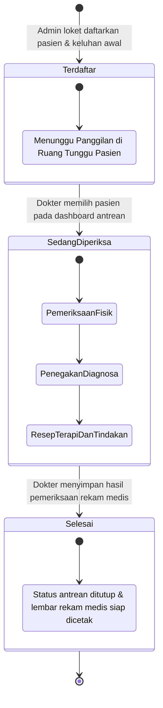
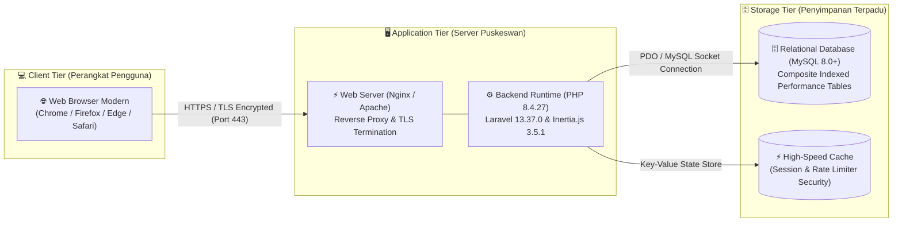

<p align="center">
  
</p>

<h1 align="center">PuskeswanApp V.2.0.0</h1>

<p align="center">
  <strong>Sistem Informasi Pelayanan Kesehatan Hewan, Rekam Medis Veteriner & Surveilans Zoonosis Terpadu</strong><br>
  <em>UPTD Pusat Kesehatan Hewan (Puskeswan) dan Inseminasi Buatan (IB) Kota Pariaman</em><br>
  Dinas Pertanian, Pangan dan Perikanan Kota Pariaman
</p>

<p align="center">
  <a href="#-teknologi-yang-digunakan-tech-stack"></a>
  <a href="#-teknologi-yang-digunakan-tech-stack"></a>
  <a href="#-teknologi-yang-digunakan-tech-stack"></a>
  <a href="#-teknologi-yang-digunakan-tech-stack"></a>
  <a href="#-teknologi-yang-digunakan-tech-stack"></a>
  <a href="#-teknologi-yang-digunakan-tech-stack"></a>
  <a href="#-teknologi-yang-digunakan-tech-stack"></a>
  <a href="#-verifikasi-kualitas-kode--pengujian-otomatis"></a>
  <a href="LICENSE"></a>
</p>

---

## 📑 Daftar Isi

- [🏛️ Tentang Instansi](#️-tentang-instansi)
- [📋 Tugas Pokok & Fungsi Puskeswan](#-tugas-pokok--fungsi-puskeswan)
- [🔄 Alur Pelayanan Poliklinik Terpadu](#-alur-pelayanan-poliklinik-terpadu)
- [📐 Pemodelan Sistem & Diagram UML (Non-Sensitif)](#-pemodelan-sistem--diagram-uml-non-sensitif)
- [✨ Fitur-Fitur Utama](#-fitur-fitur-utama)
- [🛠️ Spesifikasi Teknologi Rinci (Tech Stack)](#️-spesifikasi-teknologi-rinci-tech-stack)
- [⚡ Optimasi Kinerja Basis Data (Laravel Debugbar)](#-optimasi-kinerja-basis-data-laravel-debugbar)
- [👥 Matriks Hak Akses Peran Pengguna](#-matriks-hak-akses-peran-pengguna)
- [📸 Dokumentasi Visual Antarmuka (Screenshots)](#-dokumentasi-visual-antarmuka-screenshots)
- [🧪 Verifikasi Kualitas Kode & Pengujian Otomatis](#-verifikasi-kualitas-kode--pengujian-otomatis)
- [📄 Lisensi & Riwayat Pembaruan](#-lisensi--riwayat-pembaruan)

---

## 🏛️ Tentang Instansi

**Pusat Kesehatan Hewan (Puskeswan)** merupakan unit pelaksana teknis daerah di bidang kesehatan hewan yang menyelenggarakan pelayanan medik veteriner secara langsung kepada masyarakat dan peternak. Keberadaan Puskeswan berperan sebagai garda terdepan dalam menjaga kesehatan hewan kesayangan, meningkatkan produktivitas ternak rakyat, melindungi masyarakat dari ancaman penyakit menular asal hewan (*zoonosis*), serta menjamin keamanan pangan asal hewan.

Melalui integrasi unit **Inseminasi Buatan (IB)**, Puskeswan juga menjalankan fungsi strategis dalam peningkatan mutu genetik dan populasi ternak ruminansia (sapi potong dan kerbau) guna mendukung ketahanan pangan daerah Kota Pariaman.

---

## 📋 Tugas Pokok & Fungsi Puskeswan

1. **Pelayanan Medik Veteriner & Poliklinik Hewan:** Pemeriksaan fisik klinis, diagnosa patologis, pengobatan kuratif, pemberian multivitamin/antiparasit, sterilisasi (*ovariohisterektomi* & *kastrasi*), hingga tindakan bedah minor bagi hewan kesayangan maupun ternak masyarakat.
2. **Pengendalian Penyakit Hewan Menular Strategis (PHMS) & Zoonosis:** Pelaksanaan program vaksinasi massal—khususnya **Vaksinasi Rabies** pada Hewan Penular Rabies (HPR: anjing, kucing, kera, musang), serta vaksinasi ternak (*Septicaemia Epizootica*, *Newcastle Disease*, *Avian Influenza*).
3. **Surveilans & Respons Cepat Kasus Gigitan Rabies (GHPR):** Pencatatan epidemiologi kasus gigitan, pemantauan masa observasi klinis hewan penggigit selama 14 hari, dan monitoring kepatuhan Vaksin Anti Rabies (VAR) bagi korban dengan pendekatan *One Health*.
4. **Pelayanan Inseminasi Buatan (IB) & Reproduksi Ternak:** Layanan kawin suntik semen beku bersertifikat, Pemeriksaan Kebuntingan (PKB), penanganan gangguan reproduksi (*repeat breeder*, *anestrus*, *distokia*), dan pendampingan kelahiran.
5. **Kesehatan Masyarakat Veteriner (Kesmavet):** Pengawasan higiene sanitasi, pemeriksaan *antemortem* & *postmortem* hewan kurban, jaminan pangan **ASUH** (*Aman, Sehat, Utuh, Halal*), dan penerbitan Surat Keterangan Kesehatan Hewan (SKKH).
6. **Pelayanan Kesehatan Hewan Keliling:** Pelayanan jemput bola ke kelompok tani ternak di nagari dan desa untuk pengobatan massal dan biosekuriti kandang.

---

## 🔄 Alur Pelayanan Poliklinik Terpadu

Diagram alir berikut mengilustrasikan siklus pelayanan pasien dari kedatangan pemilik hingga publikasi rekam medis mandiri:


---

## 📐 Pemodelan Sistem & Diagram UML (Non-Sensitif)

> [!NOTE]
> Guna mematuhi standar integritas keamanan data dan melindungi struktur sistem internal, diagram tingkat implementasi yang bersifat rahasia—seperti *Entity Relationship Diagram (ERD)*, *Activity Diagram* rincian kueri logika, dan struktur relasi basis data internal—**sengaja tidak dipublikasikan secara terbuka**.
> 
> Bagian ini menampilkan pemodelan arsitektur fungsional tingkat tinggi (*high-level functional UML*) yang aman, baku, dan merefleksikan alur kerja sistem informasi terpadu PuskeswanApp:

### 1. 🎯 UML Use Case Diagram (Sistem Baru)

Memetakan hubungan antara 4 peran pengguna (*Super Admin*, *Admin Loket*, *Dokter Hewan*, dan *Masyarakat / Pemilik Pasien*) terhadap batasan fungsionalitas sistem informasi:


---

### 2. 🔄 UML State Machine Diagram (Siklus Status Kunjungan Pasien)

Menggambarkan transisi status antrean pasien secara otomatis sejak didaftarkan di loket pendaftaran, dipanggil ke ruang pemeriksaan dokter, hingga penerbitan lembar rekam medis resmi:



---

### 3. 🌐 UML Deployment Diagram (Topologi Fisik & Infrastruktur)

Menjelaskan arsitektur perangkat keras, jaringan, dan lingkungan eksekusi aplikasi secara aman:



---

## ✨ Fitur-Fitur Utama

<details open>
<summary><strong>🔍 1. Portal Cek Rekam Medis Mandiri oleh Masyarakat</strong></summary>

* **Verifikasi Identitas Aman:** Pemilik cukup memasukkan 16 digit NIK dan Nama Lengkap yang dicocokkan dengan data registrasi poliklinik.
* **Captcha Anti-Bot Dinamis:** Perlindungan dari *scraping* otomatis menggunakan generator kode acak berbasis SVG biner di sisi server.
* **Informasi Klinis Lengkap:** Menampilkan riwayat pemeriksaan, diagnosa dokter, berat badan, suhu tubuh, tindakan medis, serta rincian terapi obat.
* **Pratinjau & Cetak PDF:** Dilengkapi tombol cetak dokumen resmi rekam medis yang siap diunduh atau dicetak.
</details>

<details>
<summary><strong>📊 2. Modul Surveilans Epidemiologi Rabies (GHPR)</strong></summary>

* **Pencatatan Epidemiologi Rinci:** Mendokumentasikan identitas korban, lokasi luka gigitan, tanggal kejadian, serta kepemilikan hewan.
* **Status Hewan & Masa Observasi 14 Hari:** Pelacakan kondisi hewan penggigit (*Observasi Lapangan*, *Mati / Positif Rabies*, *Sehat*).
* **Monitoring Vaksin Anti Rabies (VAR):** Rekapitulasi status pemberian vaksin pada manusia (*Belum*, *Dosis 1*, *Lengkap*).
* **Format Cetak Laporan Resmi:** Template laporan investigasi epidemiologi untuk koordinasi lintas sektoral dengan Dinas Kesehatan.
</details>

<details>
<summary><strong>🛡️ 3. Arsitektur Keamanan Berlapis (Two-Tier Rate Limiting)</strong></summary>

* **Tier 1 (Cooldown 20 Detik):** Jika pengguna salah memasukkan kredensial 5 kali berturut-turut, tombol login dinonaktifkan sementara dengan timer hitung mundur.
* **Tier 2 (IP Block 30 Menit):** Jika penalti cooldown terulang hingga 3 kali (3 *strikes*), alamat IP penyerang diblokir total selama 30 menit ke halaman error `429 Too Many Requests`.
* **Zero-Trust Upload Validation:** Seluruh unggahan foto profil dan gambar artikel diperiksa biner *magic bytes*-nya menggunakan ekstensi PHP `finfo` dan `getimagesize()` untuk mencegah penyelundupan *web shell*.
</details>

<details>
<summary><strong>📦 4. Manajemen Logistik Obat & Inventaris Klinik</strong></summary>

* **Indikator Stok Cerdas:** Otomatisasi pengelompokan status obat (*Kritis: ≤ 10 unit*, *Menipis: 11–30 unit*, *Aman: > 30 unit*).
* **Inventaris Alat Medis:** Pengawasan kondisi peralatan medis dan operasional lapangan (*Baik*, *Rusak Ringan*, *Rusak Berat*) lengkap dengan riwayat pencatatan penanggung jawab.
</details>

---

## 🛠️ Spesifikasi Teknologi Rinci (Tech Stack)

Aplikasi dibangun menggunakan kombinasi pustaka dan kerangka kerja modern versi stabil terbaru:

| Komponen Arsitektur | Teknologi / Pustaka | Versi Terpasang | Peran & Deskripsi Kunci |
| :--- | :--- | :---: | :--- |
| **Backend Runtime** | **PHP** | `v8.4.27 (NTS x64)` | Runtime modern dengan performa JIT engine dan konstruktor properti terpromosi |
| **Backend Framework** | **Laravel Framework** | `v13.37.0` | Framework inti MVC (Patched terhadap celah `CVE-2026-114509`) |
| **Frontend Runtime** | **Node.js** | `v24.22.1 (LTS)` | Lingkungan eksekusi JavaScript modern dengan npm `v11.19.1` |
| **Frontend Framework** | **React** | `v19.2.0` | Pustaka antarmuka pengguna berbasis komponen reaktif SPA |
| **Language Extension** | **TypeScript** | `v5.7.2` | Pengetikan statis ketat untuk mencegah *runtime type error* di antarmuka |
| **Full-Stack Adapter** | **Inertia.js Core / Laravel** | `v3.5.1` | Jembatan komunikasi server-driven SPA tanpa pembuatan REST API redundan |
| **CSS & Design Engine**| **Tailwind CSS** | `v4.0.0` | Mesin CSS generasi baru berbasis *lightningcss* untuk styling ultra cepat |
| **Iconography** | **Lucide Icons** | `v1.16.0` | Pustaka ikon SVG modern yang ringan dan konsisten |
| **Type-Safe Routing** | **Laravel Wayfinder** | `v0.1.23` | Generator otomatis fungsi rute TypeScript langsung dari controller Laravel |
| **Database Engine** | **MySQL / MariaDB** | `v8.0+ / v10.5+` | Basis data relasional dengan indeks komposit pada tabel frekuensi tinggi |
| **Automated Testing** | **Pest PHP** | `v5.3.3` | Kerangka pengujian fitur otomatis (60 Feature Tests, 100% Passed) |
| **Code Style Linter** | **Laravel Pint** | `v1.32.1` | Formatter kode otomatis berstandar PSR-12 dan panduan Laravel |
| **Build Tooling** | **Vite-Plus (VoidZero)** | `v1.4.0` | Bundler modul berkas frontend super cepat untuk lingkungan produksi |

---

## ⚡ Optimasi Kinerja Basis Data (Laravel Debugbar)

Audit menyeluruh menggunakan metrik Laravel Debugbar telah mengeliminasi inefisiensi kueri di seluruh modul:

```
[SEBELUM OPTIMASI]
Admin Dashboard  : 160+ Kueri SQL (Looping harian 30 hari x 5 kueri count)  -> Latensi: 350-600 ms
Pencarian Pasien : 1 + N Kueri SQL (Looping query kunjungan terakhir hewan)  -> N+1 Problem
Dokter Dashboard : Duplikasi 100% kueri antrean aktif & rekap grafik         -> Kueri ganda

[SETELAH OPTIMASI]
Admin Dashboard  : 5–6 Kueri SQL (Single Query GROUP BY agregasi)            -> Latensi: < 50 ms (-96%)
Pencarian Pasien : 2 Kueri SQL (Eager Loading via latestOfMany 'latestVisit')-> N+1 Terselesaikan
Dokter Dashboard : 0 Kueri Duplikat (Reuse hasil kueri agregasi 30 hari)     -> Beban berkurang 50%
```

* **Indeks Komposit yang Ditambahkan:**
  * `visits(tgl_kunjungan, status_antrean)`: Mempercepat filter antrean harian dan dashboard.
  * `examinations(id_dokter, waktu_selesai)`: Mempercepat kalkulasi grafik analitik dokter.
  * `examinations(waktu_selesai)`: Mempercepat filter laporan rekam medis berkala.

---

## 👥 Matriks Hak Akses Peran Pengguna

<details>
<summary><strong>Klik untuk melihat rincian hak akses peran (*Role Access Matrix*)</strong></summary>

| Modul & Fitur | Publik / Tamu | Petugas Loket (Admin) | Dokter Hewan | Super Administrator |
| :--- | :---: | :---: | :---: | :---: |
| **Landing Page & Edukasi** | ✅ Akses | ✅ Akses | ✅ Akses | ✅ Akses |
| **Cek Rekam Medis Mandiri** | ✅ Akses | ✅ Akses | ✅ Akses | ✅ Akses |
| **Dashboard Loket Pendaftaran** | ❌ Ditolak | ✅ Penuh | ❌ Ditolak | ❌ Ditolak |
| **Registrasi Pemilik & Pasien** | ❌ Ditolak | ✅ Penuh | ❌ Ditolak | ❌ Ditolak |
| **Manajemen Antrean Loket** | ❌ Ditolak | ✅ Penuh | ❌ Ditolak | ❌ Ditolak |
| **Surveilans Rabies (GHPR)** | ❌ Ditolak | ✅ Penuh | ❌ Ditolak | 👁️ Monitoring |
| **Dashboard Dokter Hewan** | ❌ Ditolak | ❌ Ditolak | ✅ Penuh | ❌ Ditolak |
| **Pemeriksaan & Diagnosa Medis**| ❌ Ditolak | ❌ Ditolak | ✅ Penuh | ❌ Ditolak |
| **Riwayat Pelayanan Dokter** | ❌ Ditolak | ❌ Ditolak | ✅ Penuh | ❌ Ditolak |
| **Dashboard Eksekutif** | ❌ Ditolak | ❌ Ditolak | ❌ Ditolak | ✅ Penuh |
| **Manajemen Akun Pengguna** | ❌ Ditolak | ❌ Ditolak | ❌ Ditolak | ✅ Penuh |
| **Manajemen Pegawai & Staf** | ❌ Ditolak | ❌ Ditolak | ❌ Ditolak | ✅ Penuh |
| **Logistik Obat & Inventaris** | ❌ Ditolak | ❌ Ditolak | ❌ Ditolak | ✅ Penuh |
| **Laporan & Ekspor Terpadu** | ❌ Ditolak | ❌ Ditolak | ❌ Ditolak | ✅ Penuh |
</details>

---

## 📸 Dokumentasi Visual Antarmuka (Screenshots)

Berikut adalah dokumentasi tampilan visual antarmuka sistem PuskeswanApp V.2.0.0:

---

### 🌐 1. Portal Publik & Edukasi Masyarakat (Landing Page)

#### A. Hero Section & Profil Instansi
Tampilan beranda utama dengan navigasi layanan, sambutan resmi, serta ringkasan profil UPTD Puskeswan dan IB Kota Pariaman.

<p align="center">
  
</p>

<p align="center">
  
</p>

#### B. Fitur Cek Mandiri Rekam Medis Pasien
Pencarian riwayat medis mandiri oleh pemilik hewan menggunakan 16 digit NIK dan Nama Lengkap yang dilindungi verifikasi kode captcha anti-bot.

<p align="center">
  
</p>

#### C. Portal Artikel Edukasi Kesehatan Hewan & Publikasi Staf Medis
Pusat edukasi kesehatan hewan dan vaksinasi rabies terbitan tim medis serta struktur pegawai UPTD Puskeswan Kota Pariaman.

<p align="center">
  
</p>

<p align="center">
  
</p>

#### D. Pengelompokan Kategori Edukasi, Arsip Penulis & Informasi Kontak
Arsip artikel yang dikelompokkan berdasarkan kategori topik dan profil dokter hewan penulis, serta informasi kontak poliklinik.

<p align="center">
  
</p>

<p align="center">
  
</p>

<p align="center">
  
</p>

---

### 🔐 2. Modul Autentikasi & Keamanan Berlapis

#### A. Form Login & Proteksi Rate Limiting (Tier 1 Cooldown)
Halaman login petugas terpadu dilengkapi indikator penonaktifan tombol sementara (*cooldown*) saat terdeteksi kegagalan login berulang.

<p align="center">
  
</p>

<p align="center">
  
</p>

#### B. Pemulihan Kata Sandi (Forgot & Reset Password)
Alur pemulihan kata sandi petugas menggunakan token verifikasi aman via email terdaftar.

<p align="center">
  
</p>

<p align="center">
  
</p>

#### C. Halaman Kesalahan & Proteksi Akses (403, 404, 429 IP Blocked)
Antarmuka status respon HTTP khusus, termasuk halaman 429 saat alamat IP penyerang diblokir total (Tier 2).

<p align="center">
  
</p>

<p align="center">
  
</p>

<p align="center">
  
</p>

---

### 🏥 3. Modul Petugas Administrasi & Loket Rekam Medis (Admin Role)

#### A. Dashboard Operasional Loket Admin
Kartu metrik antrean harian, grafik pelayanan rekam medis, grafik surveilans kasus gigitan rabies, serta antrean terkini.

<p align="center">
  
</p>

#### B. Pendaftaran Pasien & Manajemen Antrean Poliklinik
Pendaftaran pasien hewan baru/lama dengan autofill NIK, nomor RM otomatis, serta pemantauan antrean loket harian.

<p align="center">
  
</p>

<p align="center">
  
</p>

#### C. Riwayat Rekam Medis Selesai & Surveilans Kasus Gigitan Rabies (GHPR)
Pencatatan kasus gigitan rabies secara rinci (data korban, luka gigitan, status VAR, observasi hewan) serta rekapitulasi riwayat medis selesai.

<p align="center">
  
</p>

<p align="center">
  
</p>

<p align="center">
  
</p>

---

### 🩺 4. Modul Dokter Hewan / Medik Veteriner (Dokter Role)

#### A. Dashboard Utama Dokter Hewan
Statistik beban kerja dokter, antrean prioritas yang menunggu diperiksa, serta pasien yang baru selesai ditangani.

<p align="center">
  
</p>

#### B. Ruang Periksa Antrean & Riwayat Pelayanan Medik Dokter
Tabel antrean pasien dokter dengan pemantauan riwayat medis lampau dan formulir penegakan diagnosa klinis & terapi obat.

<p align="center">
  
</p>

<p align="center">
  
</p>

---

### 👑 5. Modul Super Administrator (Eksekutif & Tata Kelola Data Master)

#### A. Dashboard Eksekutif Super Administrator
Analisis terpadu 6 bulan terakhir yang mencakup tren kunjungan, persentase kepatuhan vaksinasi VAR, dan sebaran spesies pasien.

<p align="center">
  
</p>

#### B. Manajemen Akun Pengguna, Staf Medis & Master Jenis Hewan
Manajemen peran pengguna (*User & Role Management*), data staf medis, serta master data jenis hewan kesayangan dan ternak.

<p align="center">
  
</p>

<p align="center">
  
</p>

<p align="center">
  
</p>

#### C. Manajemen Logistik Obat, Inventaris Alat & Publikasi Edukasi
Monitoring stok obat otomatis (*Aman*, *Menipis*, *Kritis*), pencatatan inventaris alat medis, serta kurasi artikel edukasi.

<p align="center">
  
</p>

<p align="center">
  
</p>

<p align="center">
  
</p>

#### D. Pusat Laporan Terpadu & Profil Akun
Rekapitulasi data rekam medis dan kasus rabies periode dinamis yang siap difilter, serta pengaturan profil administrator.

<p align="center">
  
</p>

<p align="center">
  
</p>

<p align="center">
  
</p>

---

### 📄 6. Modul Ekspor & Cetak Dokumen Resmi

#### A. Dokumen Cetak Rekam Medis Pasien Hewan
Dokumen cetak rekam medis resmi dengan identitas pemilik, nomor RM, riwayat anamnesa, hasil diagnosa, dan terapi obat bertanda tangan dokter hewan.

<p align="center">
  
</p>

#### B. Dokumen Cetak Laporan Surveilans Kasus Gigitan Rabies (GHPR)
Format laporan epidemiologi penanganan kasus gigitan HPR yang memuat data korban, lokasi gigitan, status VAR, observasi hewan penggigit, dan legalitas kedinasan.

<p align="center">
  
</p>

---

## 🧪 Verifikasi Kualitas Kode & Pengujian Otomatis

Aplikasi dilengkapi *automated regression testing* menggunakan Pest PHP dan standardisasi gaya kode Laravel Pint:

```bash
# Menjalankan seluruh pengujian otomatis fitur (60 Tests)
php artisan test --compact

# Hasil Pengujian:
# PASS  Tests\Feature\Admin\AdminDashboardTest
# PASS  Tests\Feature\Admin\RegistrationTest
# PASS  Tests\Feature\Admin\RabiesCaseTest
# PASS  Tests\Feature\Dokter\DokterDashboardTest
# PASS  Tests\Feature\Dokter\DokterExaminationTest
# PASS  Tests\Feature\PublicMedicalRecordSearchTest
# PASS  Tests\Feature\AuthRateLimitingTest
# ... (60 test suites)
# Tests:    60 passed (447 assertions)
# Duration: 4.24s (100% Passed)
```

```bash
# Menjalankan code formatter standar PSR-12
vendor/bin/pint --dirty --format agent

# Kompilasi aset frontend produksi
npm run build
```

---

## 📄 Lisensi & Riwayat Pembaruan

* **Lisensi Perangkat Lunak:** Dilisensikan di bawah [MIT License](LICENSE).
* **Catatan Perubahan Versi:** Seluruh riwayat pembaruan, perbaikan bug, dan penambahan fitur dapat dilihat pada berkas [CHANGELOG.md](CHANGELOG.md).

---

<p align="center">
  <strong>UPTD Pusat Kesehatan Hewan & Inseminasi Buatan (IB) Kota Pariaman</strong><br>
  <em>Jl. Sidi Tukar Arif, Desa Rambai, Kec. Pariaman Selatan, Kota Pariaman, Sumatera Barat 25538</em><br>
  © 2026 PuskeswanApp. All rights reserved.
</p>
