<p align="center">
  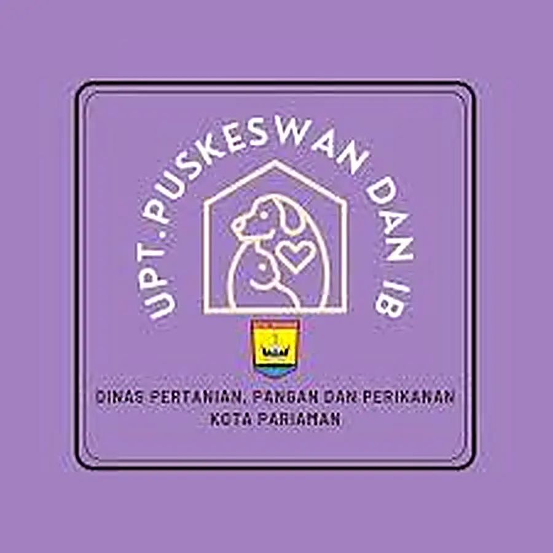
</p>

<h1 align="center">PuskeswanApp V.2.3.0</h1>

<p align="center">
  <strong>Sistem Informasi Pelayanan Kesehatan Hewan, Rekam Medis Veteriner & Surveilans Zoonosis Terpadu</strong><br>
  <em>UPTD Pusat Kesehatan Hewan (Puskeswan) dan Inseminasi Buatan (IB) Kota Pariaman</em><br>
  Dinas Pertanian, Pangan dan Perikanan Kota Pariaman
</p>

<p align="center">
  <a href="#-teknologi-yang-digunakan-tech-stack"></a>
  <a href="#-teknologi-yang-digunakan-tech-stack"></a>
  <a href="#-teknologi-yang-digunakan-tech-stack"></a>
  <a href="#-teknologi-yang-digunakan-tech-stack"></a>
  <a href="#-teknologi-yang-digunakan-tech-stack"></a>
  <a href="#-teknologi-yang-digunakan-tech-stack"></a>
  <a href="#-teknologi-yang-digunakan-tech-stack"></a>
  <a href="AUDIT.md"></a>
  <a href="LICENSE"></a>
</p>

---

## 📑 Daftar Isi

- [🏛️ Tentang Instansi](#️-tentang-instansi)
- [📋 Tugas Pokok & Fungsi Puskeswan](#-tugas-pokok--fungsi-puskeswan)
- [🔄 Alur Pelayanan Poliklinik Terpadu](#-alur-pelayanan-poliklinik-terpadu)
- [📐 Pemodelan Sistem & Diagram UML (Non-Sensitif)](#-pemodelan-sistem--diagram-uml-non-sensitif)
- [✨ Fitur-Fitur Utama](#-fitur-fitur-utama)
- [🛠️ Spesifikasi Teknologi Rinci (Tech Stack)](#️-spesifikasi-teknologi-rinci-tech-stack)
- [⚡ Optimasi Kinerja Basis Data (Laravel Debugbar)](#-optimasi-kinerja-basis-data-laravel-debugbar)
- [👥 Matriks Hak Akses Peran Pengguna](#-matriks-hak-akses-peran-pengguna)
- [📸 Dokumentasi Visual Antarmuka (Screenshots)](#-dokumentasi-visual-antarmuka-screenshots)
- [🛡️ Audit Keamanan Siber & Pen-Testing (OWASP Top 10)](#️-audit-keamanan-siber--pen-testing-owasp-top-10)
- [🧪 Verifikasi Kualitas Kode & Pengujian Otomatis](#-verifikasi-kualitas-kode--pengujian-otomatis)
- [📄 Lisensi & Riwayat Pembaruan](#-lisensi--riwayat-pembaruan)

---

## 🏛️ Tentang Instansi

**Pusat Kesehatan Hewan (Puskeswan)** merupakan unit pelaksana teknis daerah di bidang kesehatan hewan yang menyelenggarakan pelayanan medik veteriner secara langsung kepada masyarakat dan peternak. Keberadaan Puskeswan berperan sebagai garda terdepan dalam menjaga kesehatan hewan kesayangan, meningkatkan produktivitas ternak rakyat, melindungi masyarakat dari ancaman penyakit menular asal hewan (_zoonosis_), serta menjamin keamanan pangan asal hewan.

Melalui integrasi unit **Inseminasi Buatan (IB)**, Puskeswan juga menjalankan fungsi strategis dalam peningkatan mutu genetik dan populasi ternak ruminansia (sapi potong dan kerbau) guna mendukung ketahanan pangan daerah Kota Pariaman.

---

## 📋 Tugas Pokok & Fungsi Puskeswan

1. **Pelayanan Medik Veteriner & Poliklinik Hewan:** Pemeriksaan fisik klinis, diagnosa patologis, pengobatan kuratif, pemberian multivitamin/antiparasit, sterilisasi (_ovariohisterektomi_ & _kastrasi_), hingga tindakan bedah minor bagi hewan kesayangan maupun ternak masyarakat.
2. **Pengendalian Penyakit Hewan Menular Strategis (PHMS) & Zoonosis:** Pelaksanaan program vaksinasi massal—khususnya **Vaksinasi Rabies** pada Hewan Penular Rabies (HPR: anjing, kucing, kera, musang), serta vaksinasi ternak (_Septicaemia Epizootica_, _Newcastle Disease_, _Avian Influenza_).
3. **Surveilans & Respons Cepat Kasus Gigitan Rabies (GHPR):** Pencatatan epidemiologi kasus gigitan, pemantauan masa observasi klinis hewan penggigit selama 14 hari, dan monitoring kepatuhan Vaksin Anti Rabies (VAR) bagi korban dengan pendekatan _One Health_.
4. **Pelayanan Inseminasi Buatan (IB) & Reproduksi Ternak:** Layanan kawin suntik semen beku bersertifikat, Pemeriksaan Kebuntingan (PKB), penanganan gangguan reproduksi (_repeat breeder_, _anestrus_, _distokia_), dan pendampingan kelahiran.
5. **Kesehatan Masyarakat Veteriner (Kesmavet):** Pengawasan higiene sanitasi, pemeriksaan _antemortem_ & _postmortem_ hewan kurban, jaminan pangan **ASUH** (_Aman, Sehat, Utuh, Halal_), dan penerbitan Surat Keterangan Kesehatan Hewan (SKKH).
6. **Pelayanan Kesehatan Hewan Keliling:** Pelayanan jemput bola ke kelompok tani ternak di nagari dan desa untuk pengobatan massal dan biosekuriti kandang.

---

## 🔄 Alur Pelayanan Poliklinik Terpadu

Diagram alir berikut mengilustrasikan siklus pelayanan pasien dari kedatangan pemilik hingga publikasi rekam medis mandiri:

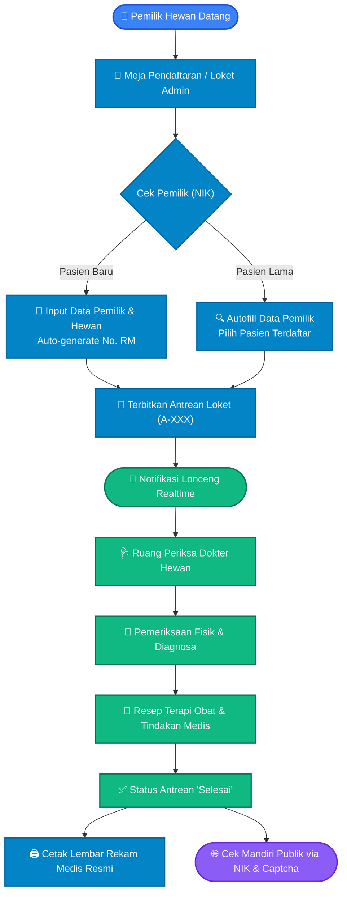

---

## 📐 Pemodelan Sistem & Diagram UML (Non-Sensitif)

### 1. 🎯 UML Use Case Diagram (Sistem Baru)

Memetakan hubungan antara 4 peran pengguna (_Super Admin_, _Admin Loket_, _Dokter Hewan_, dan _Masyarakat / Pemilik Pasien_) terhadap batasan fungsionalitas sistem informasi:

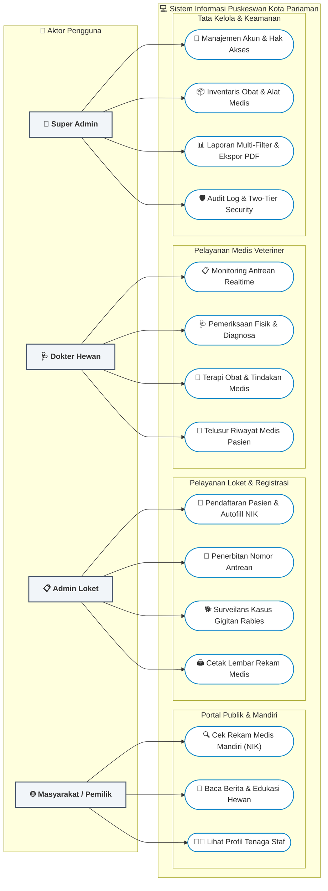

---

### 2. 🔄 UML State Machine Diagram (Siklus Status Kunjungan Pasien)

Menggambarkan transisi status antrean pasien secara otomatis sejak didaftarkan di loket pendaftaran, dipanggil ke ruang pemeriksaan dokter, hingga penerbitan lembar rekam medis resmi:

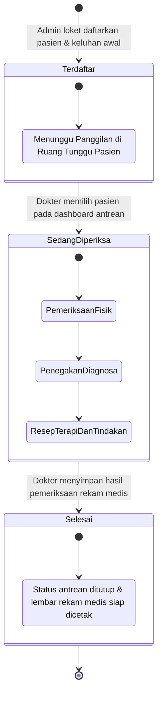

---

### 3. 🌐 UML Deployment Diagram (Topologi Fisik & Infrastruktur)

Menjelaskan arsitektur perangkat keras, jaringan, dan lingkungan eksekusi aplikasi secara aman:

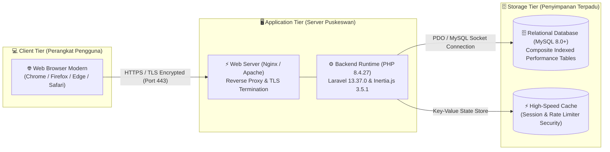

---

## ✨ Fitur-Fitur Utama

<details open>
<summary><strong>🔍 1. Portal Cek Rekam Medis Mandiri oleh Masyarakat</strong></summary>

- **Verifikasi Identitas Aman:** Pemilik cukup memasukkan 16 digit NIK dan Nama Lengkap yang dicocokkan dengan data registrasi poliklinik.
- **Captcha Anti-Bot Dinamis:** Perlindungan dari _scraping_ otomatis menggunakan generator kode acak berbasis SVG biner di sisi server.
- **Informasi Klinis Lengkap:** Menampilkan riwayat pemeriksaan, diagnosa dokter, berat badan, suhu tubuh, tindakan medis, serta rincian terapi obat.
- **Pratinjau & Cetak PDF:** Dilengkapi tombol cetak dokumen resmi rekam medis yang siap diunduh atau dicetak.
  </details>

<details>
<summary><strong>📊 2. Modul Surveilans Epidemiologi Rabies (GHPR)</strong></summary>

- **Pencatatan Epidemiologi Rinci:** Mendokumentasikan identitas korban, lokasi luka gigitan, tanggal kejadian, serta kepemilikan hewan.
- **Status Hewan & Masa Observasi 14 Hari:** Pelacakan kondisi hewan penggigit (_Observasi Lapangan_, _Mati / Positif Rabies_, _Sehat_).
- **Monitoring Vaksin Anti Rabies (VAR):** Rekapitulasi status pemberian vaksin pada manusia (_Belum_, _Dosis 1_, _Lengkap_).
- **Format Cetak Laporan Resmi:** Template laporan investigasi epidemiologi untuk koordinasi lintas sektoral dengan Dinas Kesehatan.
  </details>

<details>
<summary><strong>🛡️ 3. Arsitektur Keamanan Berlapis (Two-Tier Rate Limiting)</strong></summary>

- **Tier 1 (Cooldown 20 Detik):** Jika pengguna salah memasukkan kredensial 5 kali berturut-turut, tombol login dinonaktifkan sementara dengan timer hitung mundur.
- **Tier 2 (IP Block 30 Menit):** Jika penalti cooldown terulang hingga 3 kali (3 _strikes_), alamat IP penyerang diblokir total selama 30 menit ke halaman error `429 Too Many Requests`.
- **Zero-Trust Upload Validation:** Seluruh unggahan foto profil dan gambar artikel diperiksa biner _magic bytes_-nya menggunakan ekstensi PHP `finfo` dan `getimagesize()` untuk mencegah penyelundupan _web shell_.
  </details>

<details>
<summary><strong>📦 4. Manajemen Logistik Obat & Inventaris Klinik</strong></summary>

- **Indikator Stok Cerdas:** Otomatisasi pengelompokan status obat (_Kritis: ≤ 10 unit_, _Menipis: 11–30 unit_, _Aman: > 30 unit_).
- **Inventaris Alat Medis:** Pengawasan kondisi peralatan medis dan operasional lapangan (_Baik_, _Rusak Ringan_, _Rusak Berat_) lengkap dengan riwayat pencatatan penanggung jawab.
  </details>

---

## 🛠️ Spesifikasi Teknologi Rinci (Tech Stack)

Aplikasi dibangun menggunakan kombinasi pustaka dan kerangka kerja modern versi stabil terbaru:

| Komponen Arsitektur     | Teknologi / Pustaka           |   Versi Terpasang   | Peran & Deskripsi Kunci                                                       |
| :---------------------- | :---------------------------- | :-----------------: | :---------------------------------------------------------------------------- |
| **Backend Runtime**     | **PHP**                       | `v8.4.27 (NTS x64)` | Runtime modern dengan performa JIT engine dan konstruktor properti terpromosi |
| **Backend Framework**   | **Laravel Framework**         |     `v13.37.0`      | Framework inti MVC (Patched terhadap celah `CVE-2026-114509`)                 |
| **Frontend Runtime**    | **Node.js**                   |  `v24.22.1 (LTS)`   | Lingkungan eksekusi JavaScript modern dengan npm `v11.19.1`                   |
| **Frontend Framework**  | **React**                     |      `v19.2.0`      | Pustaka antarmuka pengguna berbasis komponen reaktif SPA                      |
| **Language Extension**  | **TypeScript**                |      `v5.7.2`       | Pengetikan statis ketat untuk mencegah _runtime type error_ di antarmuka      |
| **Full-Stack Adapter**  | **Inertia.js Core / Laravel** |      `v3.5.1`       | Jembatan komunikasi server-driven SPA tanpa pembuatan REST API redundan       |
| **CSS & Design Engine** | **Tailwind CSS**              |      `v4.0.0`       | Mesin CSS generasi baru berbasis _lightningcss_ untuk styling ultra cepat     |
| **Iconography**         | **Lucide Icons**              |      `v1.16.0`      | Pustaka ikon SVG modern yang ringan dan konsisten                             |
| **Type-Safe Routing**   | **Laravel Wayfinder**         |      `v0.1.23`      | Generator otomatis fungsi rute TypeScript langsung dari controller Laravel    |
| **Database Engine**     | **MySQL / MariaDB**           |  `v8.0+ / v10.5+`   | Basis data relasional dengan indeks komposit pada tabel frekuensi tinggi      |
| **Automated Testing**   | **Pest PHP**                  |      `v5.3.3`       | Kerangka pengujian fitur otomatis (75 Feature & Security Tests, 100% Passed)   |
| **Code Style Linter**   | **Laravel Pint**              |      `v1.32.1`      | Formatter kode otomatis berstandar PSR-12 dan panduan Laravel                 |
| **Build Tooling**       | **Vite-Plus (VoidZero)**      |      `v1.4.0`       | Bundler modul berkas frontend super cepat untuk lingkungan produksi           |

---

## ⚡ Optimasi Kinerja Basis Data (Laravel Debugbar)

Audit menyeluruh menggunakan metrik Laravel Debugbar telah mengeliminasi inefisiensi kueri di seluruh modul:

```
[SEBELUM OPTIMASI]
Admin Dashboard  : 160+ Kueri SQL (Looping harian 30 hari x 5 kueri count)  -> Latensi: 350-600 ms
Pencarian Pasien : 1 + N Kueri SQL (Looping query kunjungan terakhir hewan)  -> N+1 Problem
Dokter Dashboard : Duplikasi 100% kueri antrean aktif & rekap grafik         -> Kueri ganda

[SETELAH OPTIMASI]
Admin Dashboard  : 5–6 Kueri SQL (Single Query GROUP BY agregasi)            -> Latensi: < 50 ms (-96%)
Pencarian Pasien : 2 Kueri SQL (Eager Loading via latestOfMany 'latestVisit')-> N+1 Terselesaikan
Dokter Dashboard : 0 Kueri Duplikat (Reuse hasil kueri agregasi 30 hari)     -> Beban berkurang 50%
```

- **Indeks Komposit yang Ditambahkan:**
    - `visits(tgl_kunjungan, status_antrean)`: Mempercepat filter antrean harian dan dashboard.
    - `examinations(id_dokter, waktu_selesai)`: Mempercepat kalkulasi grafik analitik dokter.
    - `examinations(waktu_selesai)`: Mempercepat filter laporan rekam medis berkala.

---

## 👥 Matriks Hak Akses Peran Pengguna

<details>
<summary><strong>Klik untuk melihat rincian hak akses peran (*Role Access Matrix*)</strong></summary>

| Modul & Fitur                    | Publik / Tamu | Petugas Loket (Admin) | Dokter Hewan | Super Administrator |
| :------------------------------- | :-----------: | :-------------------: | :----------: | :-----------------: |
| **Landing Page & Edukasi**       |   ✅ Akses    |       ✅ Akses        |   ✅ Akses   |      ✅ Akses       |
| **Cek Rekam Medis Mandiri**      |   ✅ Akses    |       ✅ Akses        |   ✅ Akses   |      ✅ Akses       |
| **Dashboard Loket Pendaftaran**  |  ❌ Ditolak   |       ✅ Penuh        |  ❌ Ditolak  |     ❌ Ditolak      |
| **Registrasi Pemilik & Pasien**  |  ❌ Ditolak   |       ✅ Penuh        |  ❌ Ditolak  |     ❌ Ditolak      |
| **Manajemen Antrean Loket**      |  ❌ Ditolak   |       ✅ Penuh        |  ❌ Ditolak  |     ❌ Ditolak      |
| **Surveilans Rabies (GHPR)**     |  ❌ Ditolak   |       ✅ Penuh        |  ❌ Ditolak  |    👁️ Monitoring    |
| **Dashboard Dokter Hewan**       |  ❌ Ditolak   |      ❌ Ditolak       |   ✅ Penuh   |     ❌ Ditolak      |
| **Pemeriksaan & Diagnosa Medis** |  ❌ Ditolak   |      ❌ Ditolak       |   ✅ Penuh   |     ❌ Ditolak      |
| **Riwayat Pelayanan Dokter**     |  ❌ Ditolak   |      ❌ Ditolak       |   ✅ Penuh   |     ❌ Ditolak      |
| **Dashboard Eksekutif**          |  ❌ Ditolak   |      ❌ Ditolak       |  ❌ Ditolak  |      ✅ Penuh       |
| **Manajemen Akun Pengguna**      |  ❌ Ditolak   |      ❌ Ditolak       |  ❌ Ditolak  |      ✅ Penuh       |
| **Manajemen Pegawai & Staf**     |  ❌ Ditolak   |      ❌ Ditolak       |  ❌ Ditolak  |      ✅ Penuh       |
| **Logistik Obat & Inventaris**   |  ❌ Ditolak   |      ❌ Ditolak       |  ❌ Ditolak  |      ✅ Penuh       |
| **Laporan & Ekspor Terpadu**     |  ❌ Ditolak   |      ❌ Ditolak       |  ❌ Ditolak  |      ✅ Penuh       |

</details>

---

## 📸 Dokumentasi Visual Antarmuka (Screenshots)

Berikut adalah dokumentasi tampilan visual antarmuka sistem PuskeswanApp V.2.1.0:

---

### 🌐 1. Portal Publik & Edukasi Masyarakat (Landing Page)

|                                                                      1. Hero Section                                                                       |                                                               2. Profil UPTD Puskeswan                                                                |                                                            3. Cek Mandiri Rekam Medis                                                             |                                                                    4. Artikel Edukasi Kesehatan                                                                    |
| :--------------------------------------------------------------------------------------------------------------------------------------------------------: | :---------------------------------------------------------------------------------------------------------------------------------------------------: | :-----------------------------------------------------------------------------------------------------------------------------------------------: | :----------------------------------------------------------------------------------------------------------------------------------------------------------------: |
| <a href="screenshot/index/1_hero_section.png">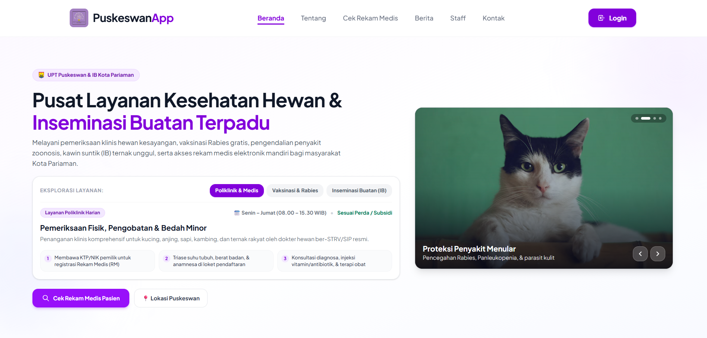</a> | <a href="screenshot/index/2_about_section.png">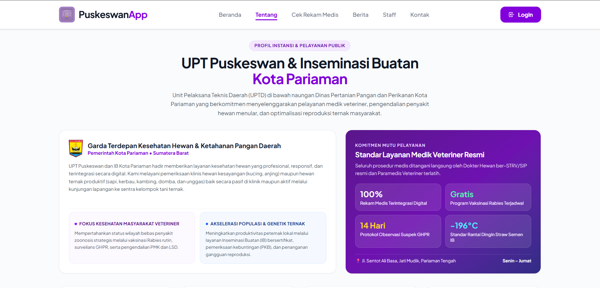</a> | <a href="screenshot/index/3_cek_section.png">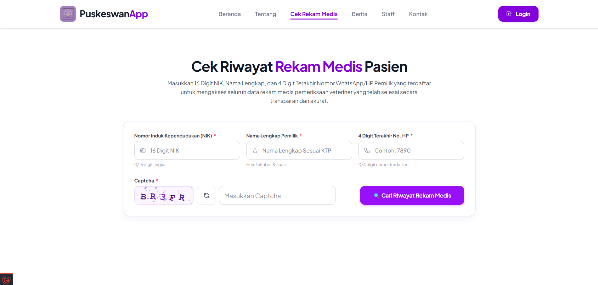</a> | <a href="screenshot/index/4_article_section.png">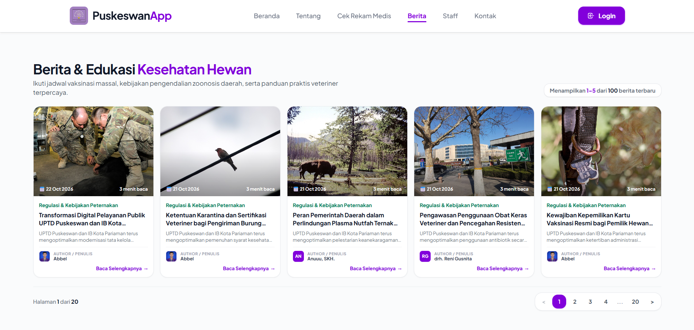</a> |

|                                                                     5. Struktur Tenaga Staf                                                                      |                                                             6. Direktori Kategori Edukasi                                                              |                                                                   7. Arsip Berdasarkan Penulis                                                                    |                                                                 8. Lokasi Poliklinik & Kontak                                                                  |
| :--------------------------------------------------------------------------------------------------------------------------------------------------------------: | :----------------------------------------------------------------------------------------------------------------------------------------------------: | :---------------------------------------------------------------------------------------------------------------------------------------------------------------: | :------------------------------------------------------------------------------------------------------------------------------------------------------------: |
| <a href="screenshot/index/5_staff_section.png">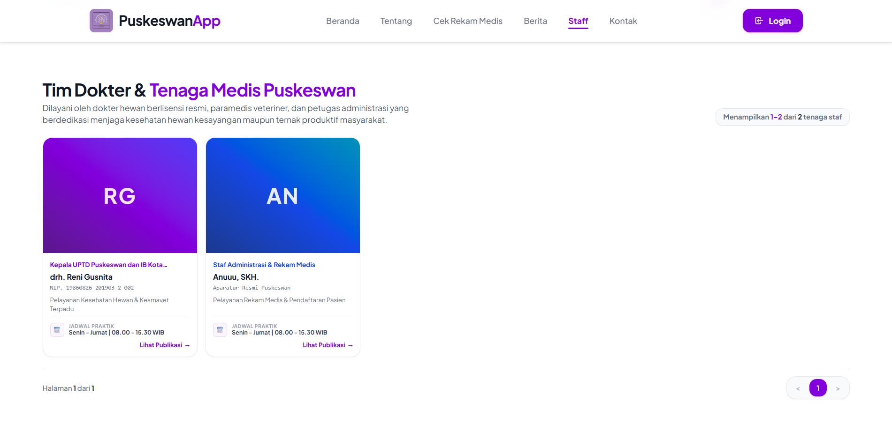</a> | <a href="screenshot/index/7_category_section.png">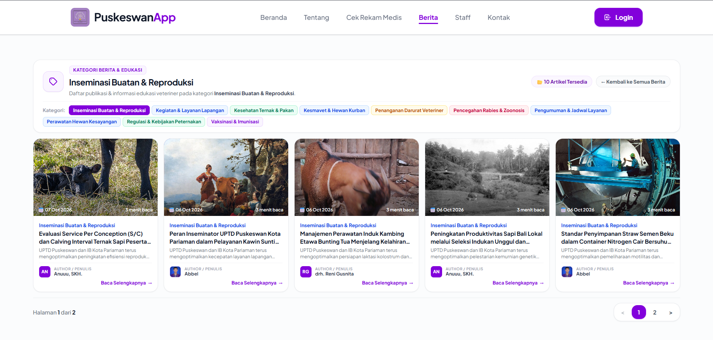</a> | <a href="screenshot/index/8_author_section.png">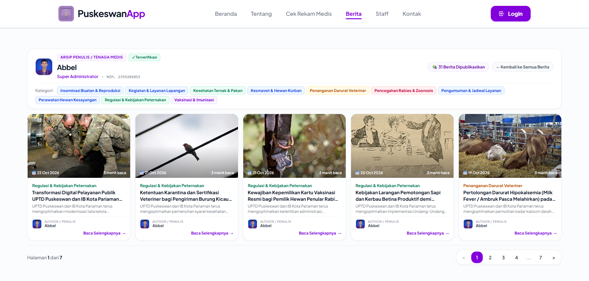</a> | <a href="screenshot/index/6_contact_section.png">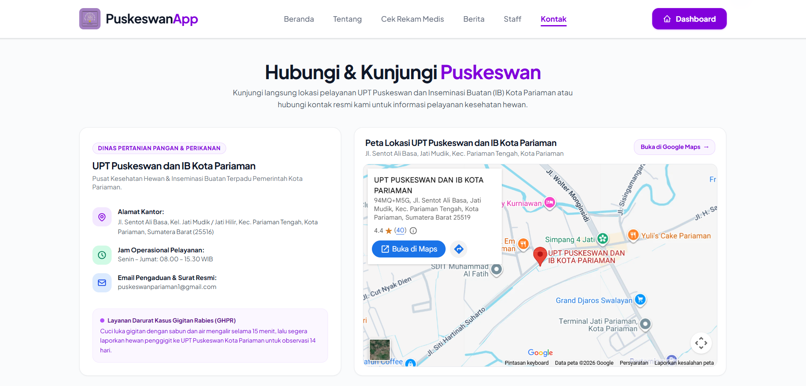</a> |

---

### 🔐 2. Modul Autentikasi & Keamanan Berlapis

|                                                        1. Form Login Petugas                                                         |                                                                    2. Cooldown Tombol (Tier 1)                                                                    |                                                         3. Form Lupa Kata Sandi                                                          |                                                           4. Reset Kata Sandi Baru                                                           |
| :----------------------------------------------------------------------------------------------------------------------------------: | :---------------------------------------------------------------------------------------------------------------------------------------------------------------: | :--------------------------------------------------------------------------------------------------------------------------------------: | :------------------------------------------------------------------------------------------------------------------------------------------: |
| <a href="screenshot/auth/login_section.png">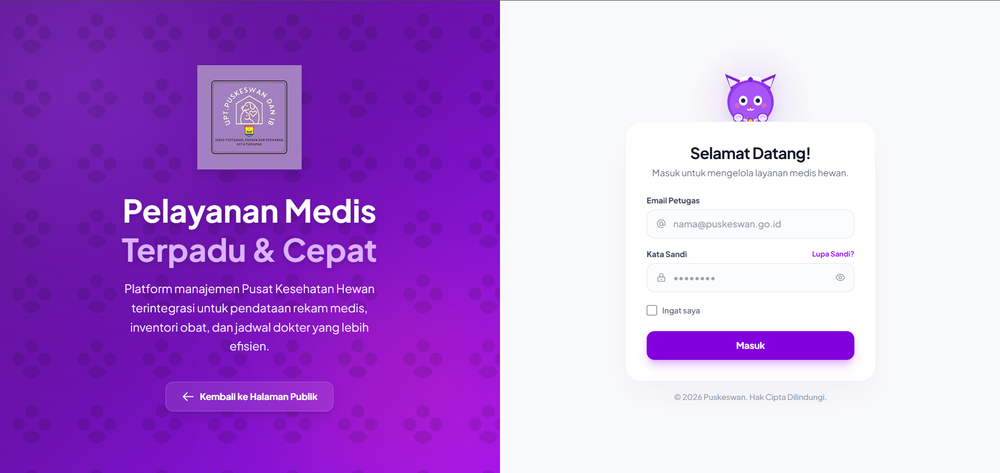</a> | <a href="screenshot/auth/rate_limiting_section.png">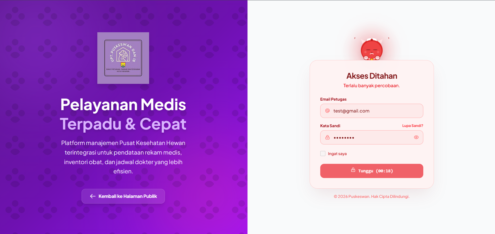</a> | <a href="screenshot/auth/forgot_section.png">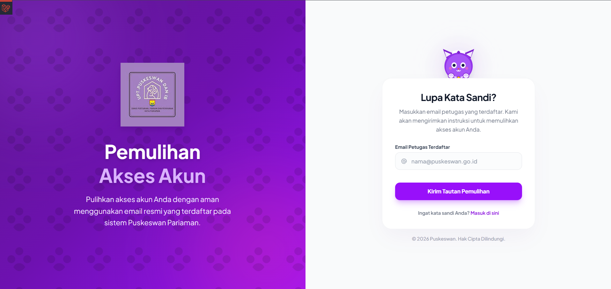</a> | <a href="screenshot/auth/reset_section.png">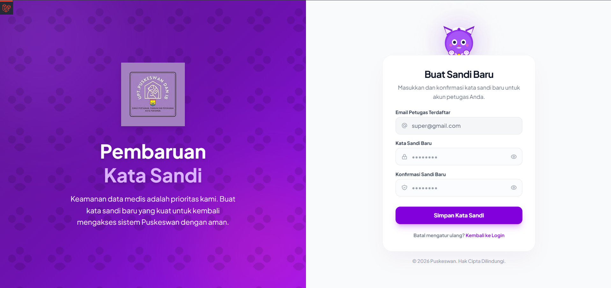</a> |

|                                                         5. Akses Ditolak (403 Forbidden)                                                          |                                                  6. Halaman Tidak Ditemukan (404)                                                   |                                                          7. IP Blocked Penalti 30 Menit (429)                                                          |
| :-----------------------------------------------------------------------------------------------------------------------------------------------: | :---------------------------------------------------------------------------------------------------------------------------------: | :----------------------------------------------------------------------------------------------------------------------------------------------------: |
| <a href="screenshot/auth/403_section.png">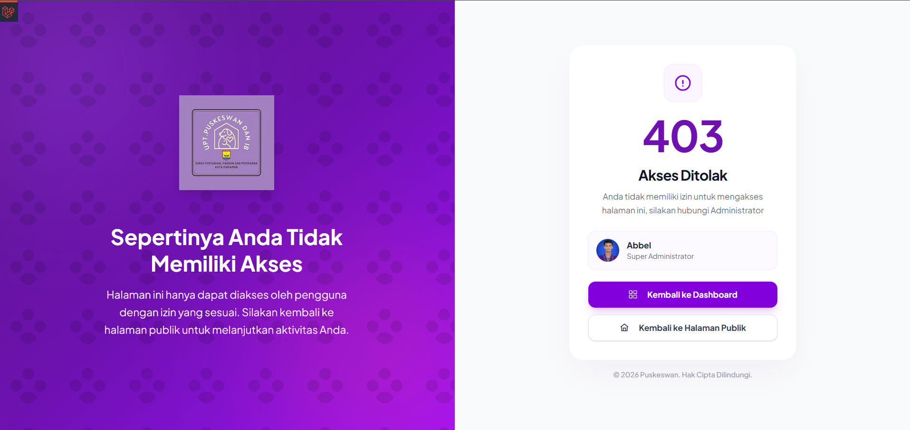</a> | <a href="screenshot/auth/404_section.png">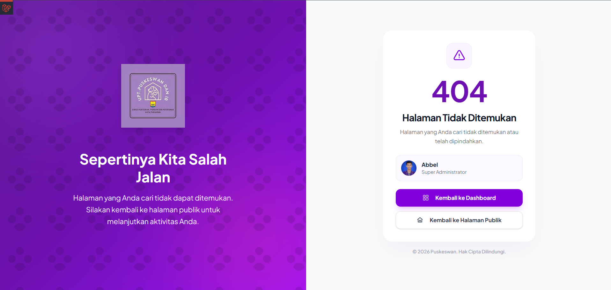</a> | <a href="screenshot/auth/429_section.png">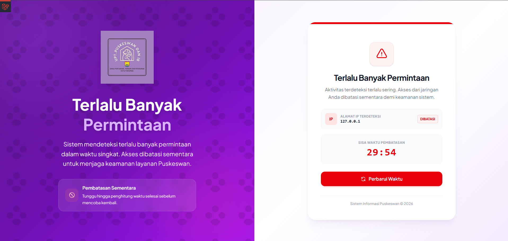</a> |

---

### 🏥 3. Modul Petugas Administrasi & Loket Rekam Medis (Admin Role)

|                                                    1. Dashboard Operasional Loket                                                     |                                                      2. Formulir Registrasi (Autofill NIK)                                                       |                                                               3. Pemantauan Antrean Hari Ini                                                                |
| :-----------------------------------------------------------------------------------------------------------------------------------: | :----------------------------------------------------------------------------------------------------------------------------------------------: | :---------------------------------------------------------------------------------------------------------------------------------------------------------: |
| <a href="screenshot/admin/1_dashboard.png">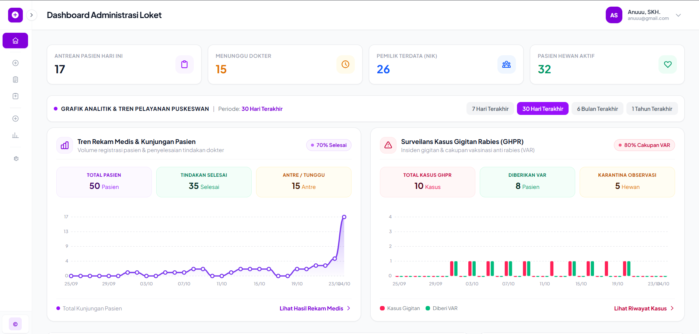</a> | <a href="screenshot/admin/2_visit_add.png">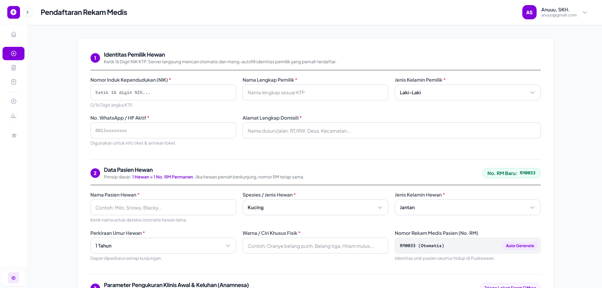</a> | <a href="screenshot/admin/3_visit_list.png">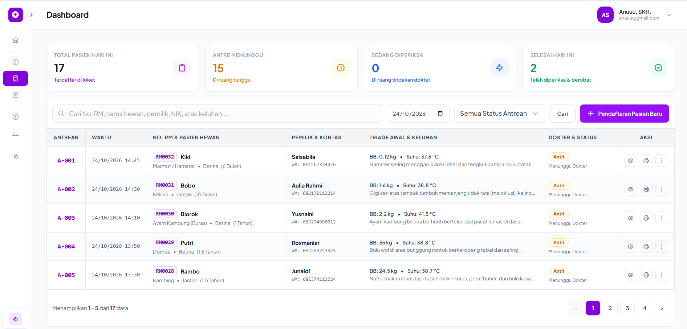</a> |

|                                                                4. Riwayat Rekam Medis Selesai                                                                 |                                                          5. Input Kasus Gigitan Rabies (GHPR)                                                          |                                                                6. Monitoring Epidemiologi GHPR                                                                 |
| :-----------------------------------------------------------------------------------------------------------------------------------------------------------: | :----------------------------------------------------------------------------------------------------------------------------------------------------: | :------------------------------------------------------------------------------------------------------------------------------------------------------------: |
| <a href="screenshot/admin/4_visit_history.png">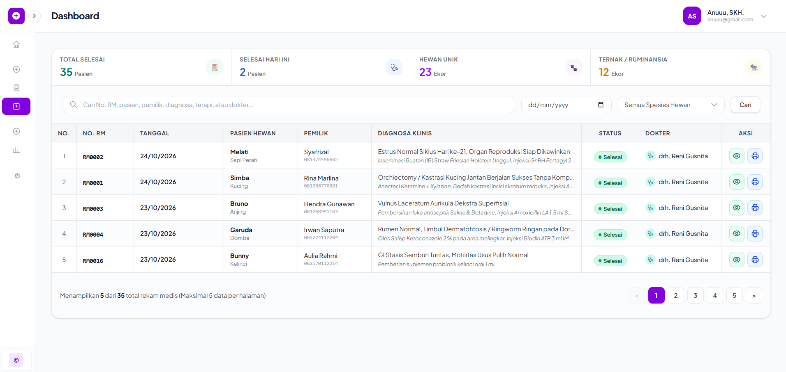</a> | <a href="screenshot/admin/5_ghpr_add.png">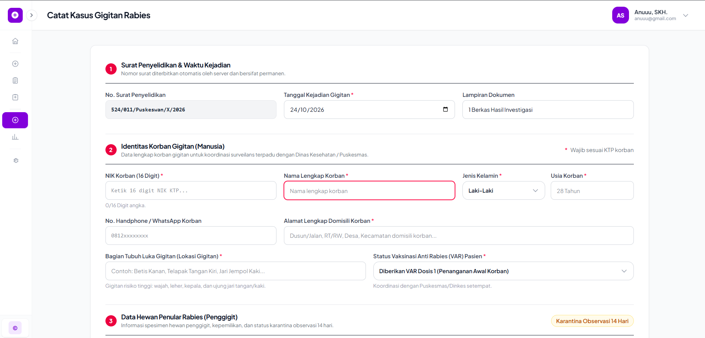</a> | <a href="screenshot/admin/6_ghpr_history.png">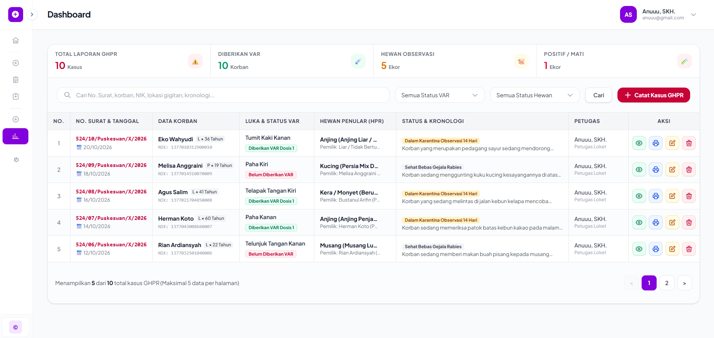</a> |

---

### 🩺 4. Modul Dokter Hewan / Medik Veteriner (Dokter Role)

|                                                     1. Dashboard Beban Kerja Dokter                                                      |                                                      2. Ruang Periksa & Antrean Pasien                                                       |                                                                 3. Riwayat Diagnosa & Rekam Medis                                                                 |
| :--------------------------------------------------------------------------------------------------------------------------------------: | :------------------------------------------------------------------------------------------------------------------------------------------: | :---------------------------------------------------------------------------------------------------------------------------------------------------------------: |
| <a href="screenshot/doctor/1_dashboard.png">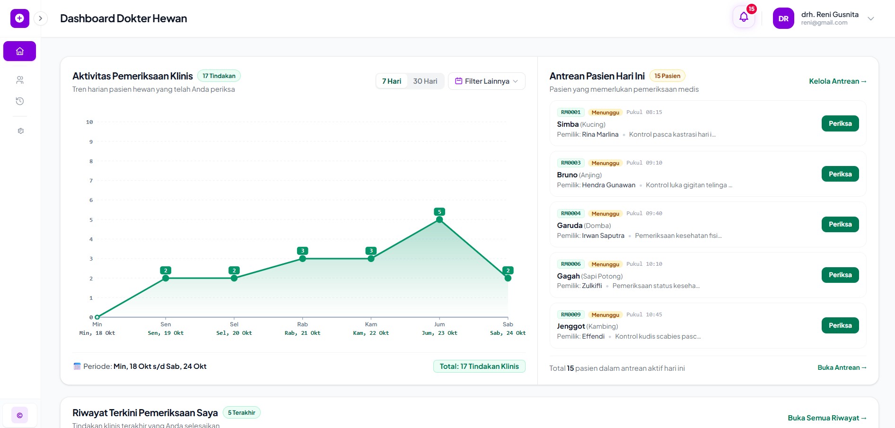</a> | <a href="screenshot/doctor/2_visit.png">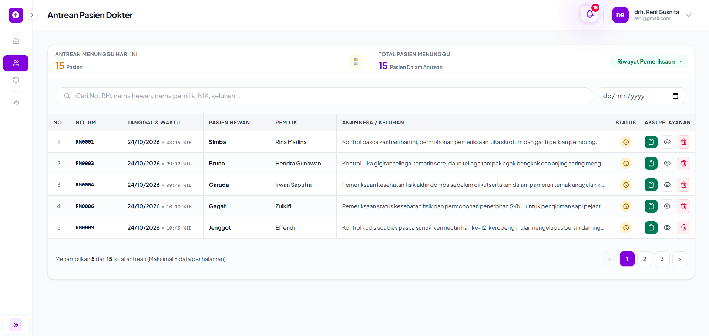</a> | <a href="screenshot/doctor/3_visit_history.png">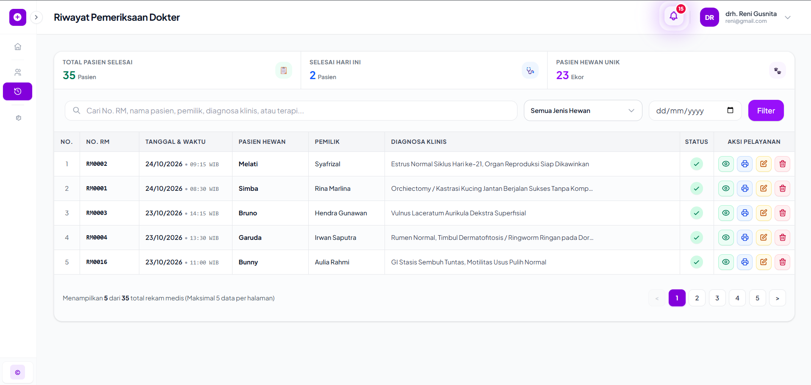</a> |

---

### 👑 5. Modul Super Administrator (Eksekutif & Tata Kelola Data Master)

|                                                               1. Dashboard Analisis Eksekutif                                                               |                                                        2. Manajemen Akun Pengguna                                                         |                                                            3. Tata Kelola Data Tenaga Staf                                                            |
| :---------------------------------------------------------------------------------------------------------------------------------------------------------: | :---------------------------------------------------------------------------------------------------------------------------------------: | :---------------------------------------------------------------------------------------------------------------------------------------------------: |
| <a href="screenshot/super_admin/1_dashboard.png">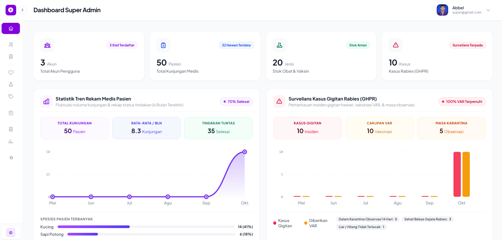</a> | <a href="screenshot/super_admin/2_user.png">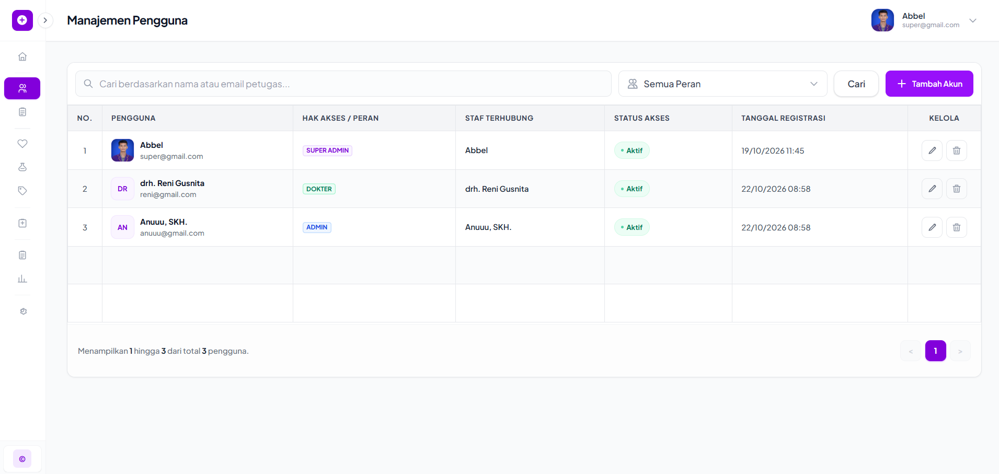</a> | <a href="screenshot/super_admin/3_staff.png">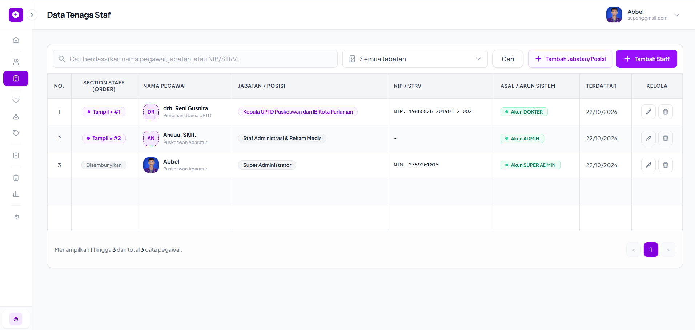</a> |

|                                                                   4. Master Data Jenis Hewan                                                                    |                                                                5. Manajemen Stok Obat & Vaksin                                                                 |                                                                6. Inventaris Peralatan Medis                                                                |
| :-------------------------------------------------------------------------------------------------------------------------------------------------------------: | :------------------------------------------------------------------------------------------------------------------------------------------------------------: | :---------------------------------------------------------------------------------------------------------------------------------------------------------: |
| <a href="screenshot/super_admin/4_animal_category.png">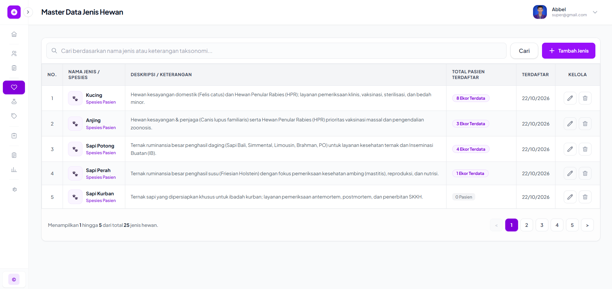</a> | <a href="screenshot/super_admin/5_examination.png">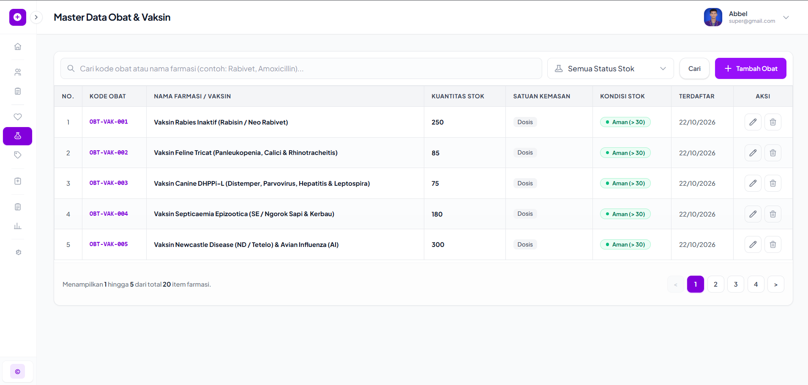</a> | <a href="screenshot/super_admin/6_inventory.png">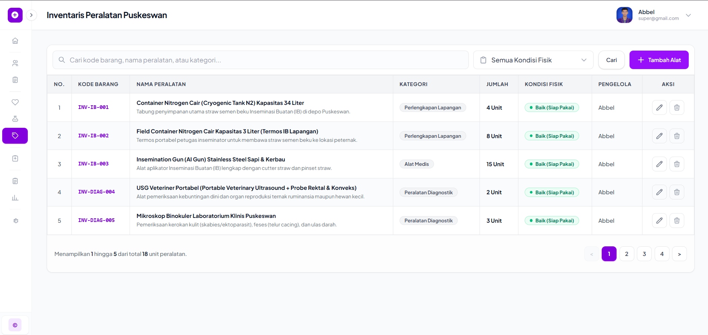</a> |

|                                                                 7. Manajemen Konten Edukasi                                                                  |                                                                      8. Laporan Kunjungan Terpadu                                                                       |                                                                     9. Laporan Kasus Rabies (GHPR)                                                                     |                                                               10. Pengaturan Profil Akun                                                                |
| :----------------------------------------------------------------------------------------------------------------------------------------------------------: | :---------------------------------------------------------------------------------------------------------------------------------------------------------------------: | :--------------------------------------------------------------------------------------------------------------------------------------------------------------------: | :-----------------------------------------------------------------------------------------------------------------------------------------------------: |
| <a href="screenshot/super_admin/7_article.png">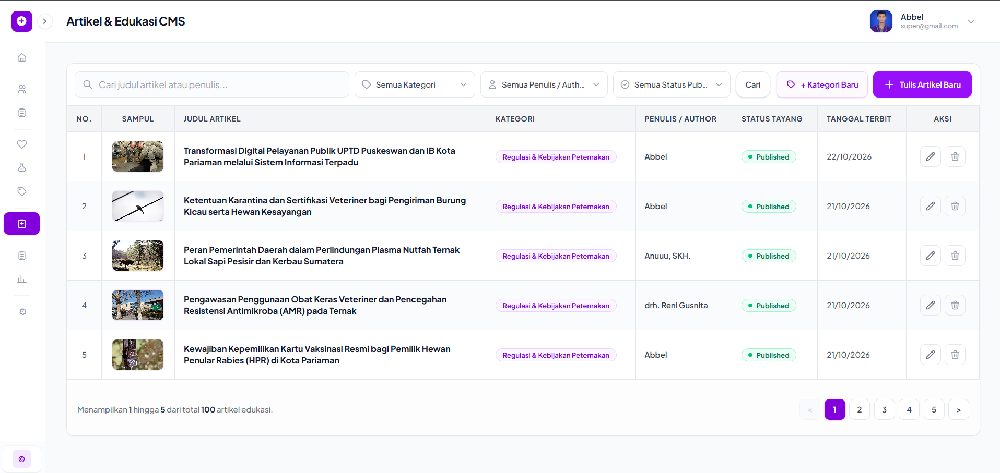</a> | <a href="screenshot/super_admin/8_history_visit.png">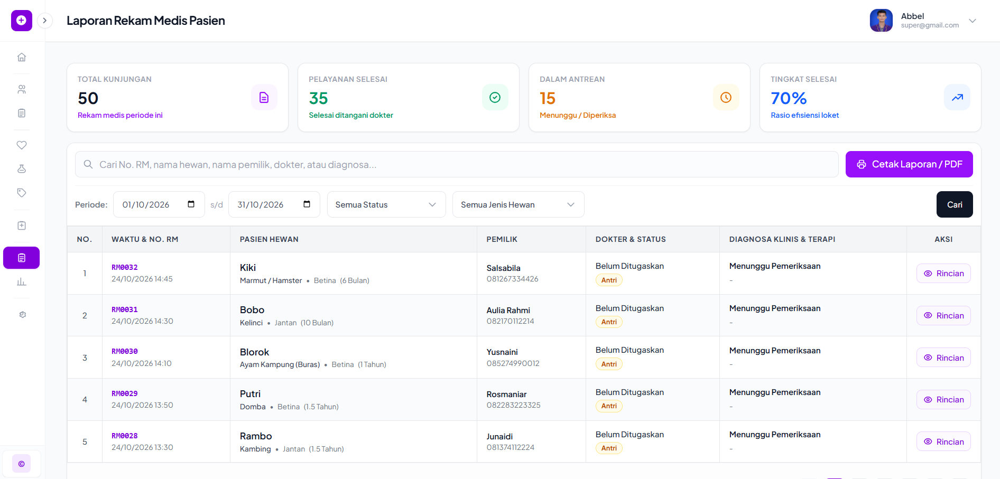</a> | <a href="screenshot/super_admin/9_history_ghpr.png">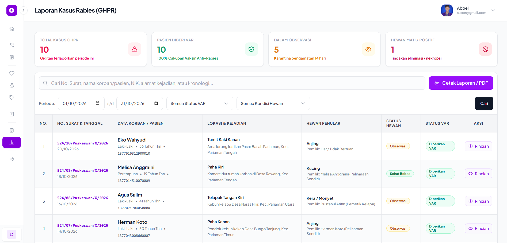</a> | <a href="screenshot/super_admin/10_profil.png">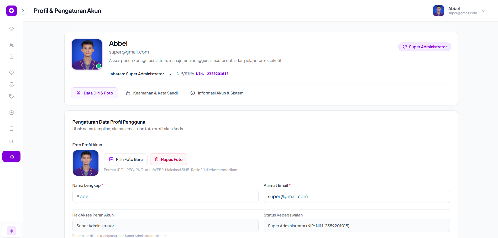</a> |

---

### 📄 6. Modul Ekspor & Format Cetak Dokumen Kedinasan

|                                                            1. Format Cetak Lembar Rekam Medis Resmi                                                            |                                                          2. Format Cetak Laporan Surveilans Rabies (GHPR)                                                          |
| :------------------------------------------------------------------------------------------------------------------------------------------------------------: | :----------------------------------------------------------------------------------------------------------------------------------------------------------------: |
| <a href="screenshot/export/2_visit_export.png">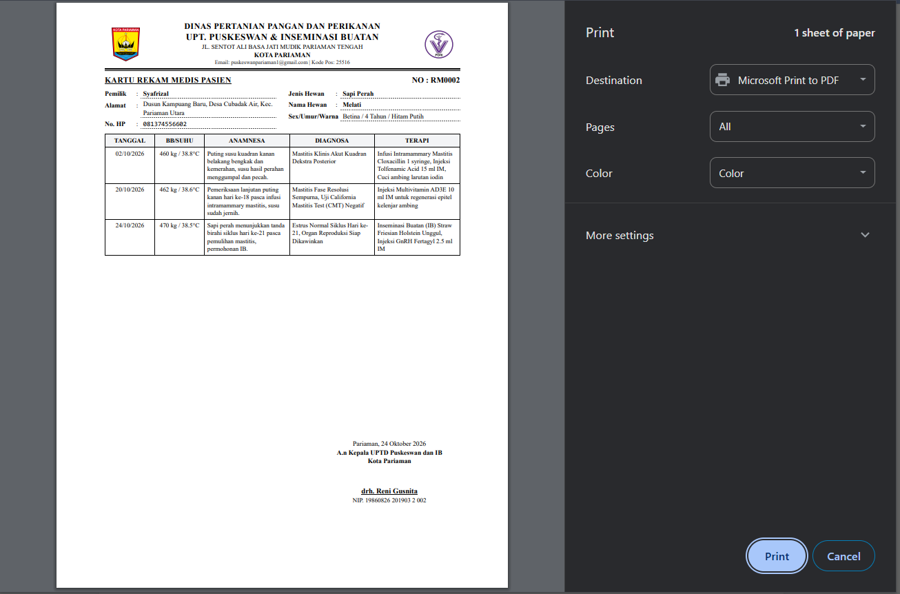</a> | <a href="screenshot/export/3_ghpr_export.png">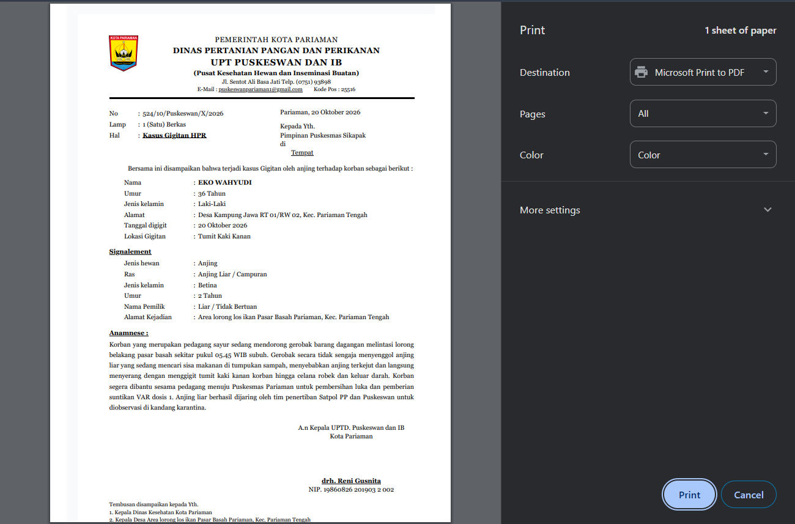</a> |

---

## 🛡️ Audit Keamanan Siber & Pen-Testing (OWASP Top 10)

Sistem **PuskeswanApp** telah melalui pengujian penetrasi keamanan mendalam (*Full-Spectrum Penetration Testing*) berbasis standar internasional **OWASP Top 10:2021** dan pengujian integritas arsitektur/routing.

### Ringkasan Hasil Audit Keamanan:
- **Total Skenario Diuji:** 42 Skenario (Terbagi dalam 7 Batch Komprehensif)
- **Status Pertahanan:** **42 Defended (100% Kebal / Lolos)**
- **Kerentanan Berhasil Dieksploitasi:** **0 (Zero Vulnerability)**
- **Peringkat Keamanan:** **Grade A+ (Hardened - Production Ready)**

| Batch | Kategori OWASP Top 10 | Skenario | Status |
| :---: | :--- | :---: | :---: |
| **Batch 1** | **A01: Broken Access Control & IDOR** (Eskalasi Super Admin/Loket, IDOR Pasien, Path Traversal, CORS) | 7 Skenario | `[DEFENDED]` |
| **Batch 2** | **A02: Cryptographic Failures** (Enforce HTTPS, Hash BCrypt Cost 12, Cookie HttpOnly/SameSite, Props Safe) | 4 Skenario | `[DEFENDED]` |
| **Batch 3** | **A03: Injection Attacks** (SQLi Pencarian, Time-based Blind SQLi, Stored XSS, Reflected XSS, Host Poisoning) | 6 Skenario | `[DEFENDED]` |
| **Batch 4** | **A04: Insecure Design & Anti-Bot** (Invisible Honeypot Trap, Verifikasi 3-Lapis Rekam Medis, Rate Limiting) | 3 Skenario | `[DEFENDED]` |
| **Batch 5** | **A05: Security Misconfiguration** (Akses `.env`/`.git` Ditolak, -Indexes Disabled, Security Headers, Clean 404) | 4 Skenario | `[DEFENDED]` |
| **Batch 6** | **A06 & A07: Authentication & Components** (Brute Force Cooldown, IP Quarantine 429, Session Zombie Revoke, PHP 8.4) | 8 Skenario | `[DEFENDED]` |
| **Batch 7** | **A08, A09, A10 & Routing** (Mass Assignment Guard, CSRF Stripping, Anti-Webshell, No-Exec Storage, Fallback 404) | 10 Skenario | `[DEFENDED]` |

> 📑 **Laporan Audit Forensik Lengkap:**  
> Rincian lengkap metodologi, analisis vektor serangan, dan mekanisme pertahanan teknis didokumentasikan secara formal pada berkas [**`AUDIT.md`**](AUDIT.md).
> 
> 📷 **Bukti Visual Tangkapan Layar:**  
> Seluruh checklist 42 skenario terangkum dalam [**`test/screenshot/MASTER_AUDIT_SUMMARY_REPORT.png`**](test/screenshot/MASTER_AUDIT_SUMMARY_REPORT.png) serta berkas individual di [**`test/screenshot/DEFENDED/`**](test/screenshot/DEFENDED/).

---

## 🧪 Verifikasi Kualitas Kode & Pengujian Otomatis

Aplikasi dilengkapi _automated regression testing_ menggunakan Pest PHP dan standardisasi gaya kode Laravel Pint:

```bash
# Menjalankan seluruh pengujian otomatis fitur & keamanan (75 Tests)
php artisan test --compact

# Hasil Pengujian:
# PASS  Tests\Feature\AdminModulesTest
# PASS  Tests\Feature\DokterModulesTest
# PASS  Tests\Feature\SuperAdminModulesTest
# PASS  Tests\Feature\PublicMedicalRecordSearchTest
# PASS  Tests\Feature\SecurityPenetrationTest
# PASS  Tests\Feature\AuthRateLimitingTest
# PASS  Tests\Feature\UserPhotoManagementTest
# Tests:    75 passed (572 assertions)
# Duration: 4.96s (100% Passed)
```

```bash
# Menjalankan code formatter standar PSR-12
vendor/bin/pint --dirty --format agent

# Kompilasi aset frontend produksi
npm run build
```

---

## 📄 Lisensi & Riwayat Pembaruan

- **Lisensi Perangkat Lunak:** Dilisensikan di bawah [MIT License](LICENSE).
- **Catatan Perubahan Versi:** Seluruh riwayat pembaruan, perbaikan bug, dan penambahan fitur dapat dilihat pada berkas [CHANGELOG.md](CHANGELOG.md).

---

<p align="center">
  <strong>UPTD Pusat Kesehatan Hewan & Inseminasi Buatan (IB) Kota Pariaman</strong><br>
  <em>Jl. Sentot Ali Basa, Jati Mudik, Kec. Pariaman Tengah, Kota Pariaman, Sumatera Barat 25519</em><br>
  © 2026 PuskeswanApp. All rights reserved.
</p>
