# Dokumentasi Analisis dan Perancangan Sistem Informasi Puskeswan

> Dokumentasi Teknis dan Rekayasa Perangkat Lunak untuk Naskah Skripsi

Sistem Informasi Pusat Kesehatan Hewan (Puskeswan) dirancang untuk mendigitalisasi dan mengoptimalkan layanan operasional klinik hewan—mulai dari pendaftaran pasien, manajemen rekam medis dengan nomor rekam medis permanen, pencatatan klinis harian, surveilans epidemiologi zoonosis rabies (GHPR), komunikasi real-time antar-staf via WebSockets, hingga pengelolaan pelaporan manajerial oleh Super Admin.

---

## 📋 Daftar Isi

1. [Arsitektur & Aturan Bisnis Utama](#-aturan-bisnis-utama)
2. [Struktur Aktor Sistem](#-struktur-aktor-sistem)
3. [Struktur Basis Data Konseptual (ERD)](#-struktur-basis-data-konseptual-erd)
4. [Daftar Lengkap 16 Diagram UML & Proses Bisnis](#-daftar-lengkap-16-diagram-uml--proses-bisnis)
   - [Bagian 1: Analisis Proses Bisnis (Macro Level)](#bagian-1-analisis-proses-bisnis-macro-level)
   - [Bagian 2: Analisis Kebutuhan Fungsional (User & Boundary Level)](#bagian-2-analisis-kebutuhan-fungsional-user--boundary-level)
   - [Bagian 3: Pemodelan Proses & Alur Kerja (Process Level)](#bagian-3-pemodelan-proses--alur-kerja-process-level)
   - [Bagian 4: Perancangan Struktur Data & Objek (Data & Object Level)](#bagian-4-perancangan-struktur-data--objek-data--object-level)
   - [Bagian 5: Interaksi Dinamis & Komponen Sistem (Behavioral Level)](#bagian-5-interaksi-dinamis--komponen-sistem-behavioral--modular-level)
   - [Bagian 6: Arsitektur Perangkat Lunak & Siklus Transaksi](#bagian-6-arsitektur-perangkat-lunak--siklus-transaksi-software-architecture)
   - [Bagian 7: Infrastruktur Fisik Perangkat Keras](#bagian-7-infrastruktur-fisik-perangkat-keras-physical-infrastructure-level)
5. [Struktur Direktori Dokumentasi](#-struktur-direktori-dokumentasi)

---

## 📌 Aturan Bisnis Utama

- **Nomor Rekam Medis (RM) Permanen:**
  Setiap hewan yang terdaftar mendapatkan satu nomor rekam medis unik berformat **`RM0001`** (tanpa komponen tanggal) yang berlaku seumur hidup hewan tersebut.
- **Autofill Berkelanjutan:**
  Pada kunjungan ulang, Admin tidak perlu menginput ulang data pemilik maupun identitas hewan. Cukup mencari berdasarkan **NIK Pemilik** atau **No. RM**, dan sistem secara otomatis melakukan _autofill_ pada data statis tersebut. Admin hanya fokus menginput perubahan data klinis harian.
- **Pemisahan Tugas (Segregation of Duties):**
  - **Admin:** Menginput data identitas (jika baru), melakukan pencarian/autofill, serta mencatat data klinis awal (**Berat Badan**, **Suhu Tubuh**, **Warna**, dan **Anamnesa/Keluhan**).
  - **Dokter:** Memilih kunjungan dari antrean, meninjau riwayat medis, memeriksa hewan secara langsung, serta menginput hasil pemeriksaan medis (**Diagnosa**, **Terapi/Pengobatan**, dan **Notes** opsional) yang otomatis mengubah status kunjungan menjadi **Selesai** di kedua belah pihak.
- **Komunikasi Real-Time Antar-Staf (WebSockets):**
  Petugas Admin, Dokter, dan Super Admin terhubung secara real-time via widget floating chat berbasis Laravel Reverb & Echo untuk koordinasi antrean dan pelayanan klinis darurat.
- **Master Data & Modul Pendukung:**
  - Master Data dibatasi pada **Jenis Hewan** (untuk dropdown pendaftaran) dan **Obat/Bahan Medis**.
  - Dilengkapi modul pendukung untuk Super Admin: _Inventaris_, _Artikel/Berita_ & _Staf_ (untuk halaman publik/guest site), serta _Cetak Laporan PDF Multi-Filter_.

---

## 👥 Struktur Aktor Sistem

1. **Super Admin:** Mengelola akun pengguna (Admin & Dokter), hak akses, master data, inventaris, artikel, data staf, pemantauan live antrean, moderasi chat, dan cetak laporan PDF multi-filter.
2. **Admin (Petugas Loket):** Mengelola loket pendaftaran, pencarian data, autofill berkelanjutan, pencatatan klinis awal, surveilans kasus rabies (GHPR), dan penerbitan nomor antrean.
3. **Dokter Hewan:** Mengakses daftar antrean, meninjau riwayat rekam medis, melakukan pemeriksaan klinis langsung, serta mencatat diagnosa dan terapi pengobatan.
4. **Pasien (Pemilik Hewan):** Aktor eksternal dengan akses mandiri untuk cek status rekam medis hewan peliharaan via NIK dan kode Captcha anti-bot.

---

## 🗄️ Struktur Basis Data Konseptual (ERD)

Sistem dirancang dengan entitas relasional terpadu sesuai naskah `10-erd.puml`:
`roles`, `staff`, `users`, `passkeys`, `owners`, `animal_types`, `animals`, `visits`, `examinations`, `medicines`, `inventories`, `categories`, `articles`, `rabies_cases`, dan `chat_messages`.

---

## 📊 Daftar Lengkap 16 Diagram UML & Proses Bisnis

---

### Bagian 1: Analisis Proses Bisnis (Macro Level)

#### 1. BPMN Sistem Pelayanan Manual (Sistem Lama)
Alur proses pelayanan poliklinik dan pencatatan manual sebelum sistem terkomputerisasi diterapkan.

<p align="center">
  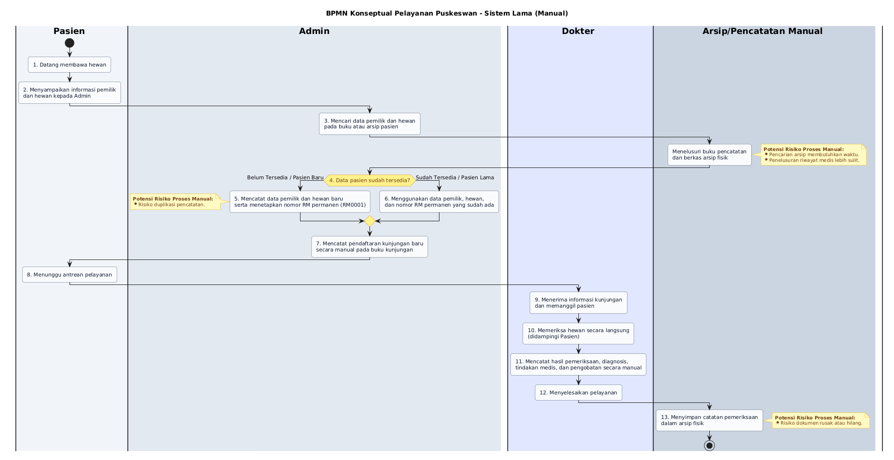
</p>

<details>
  <summary>📄 Berkas Sumber: <code>01-bpmn-sistem-lama.puml</code></summary>

[Buka file 01-bpmn-sistem-lama.puml](01-bpmn-sistem-lama.puml)
</details>

---

#### 2. BPMN Sistem Pelayanan Terpadu Baru (Berbasis Sistem)
Alur proses bisnis terotomasi setelah aplikasi PuskeswanApp diterapkan.

<p align="center">
  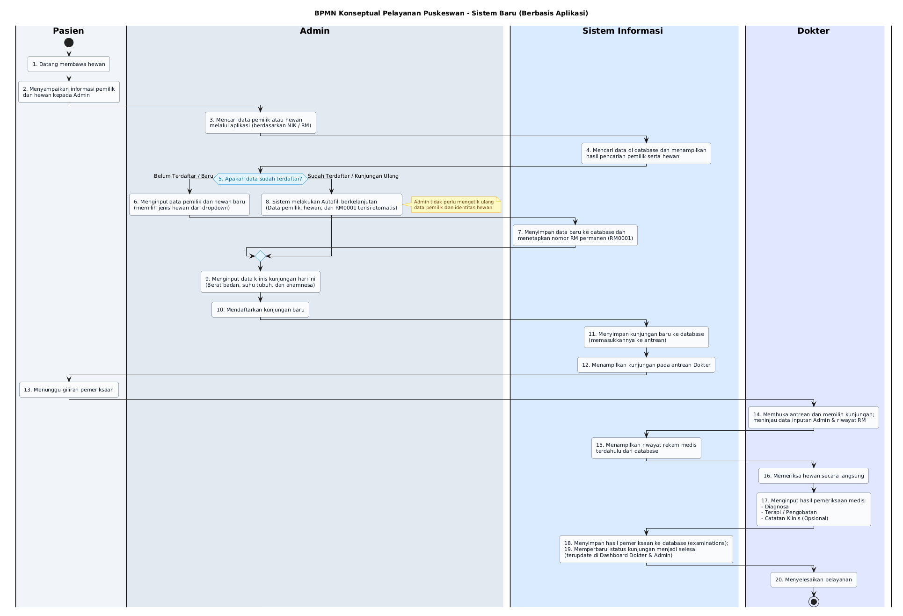
</p>

<details>
  <summary>📄 Berkas Sumber: <code>02-bpmn-sistem-baru.puml</code></summary>

[Buka file 02-bpmn-sistem-baru.puml](02-bpmn-sistem-baru.puml)
</details>

---

### Bagian 2: Analisis Kebutuhan Fungsional (User & Boundary Level)

#### 3. Use Case Diagram Sistem Lama
Batasan fungsionalitas dan interaksi aktor pada sistem manual sebelumnya.

<p align="center">
  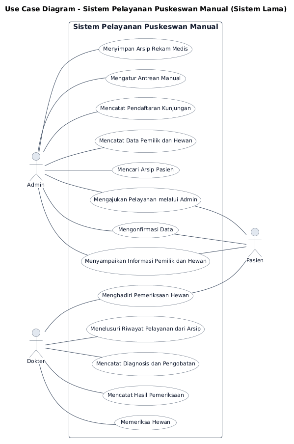
</p>

<details>
  <summary>📄 Berkas Sumber: <code>03-use-case-sistem-lama.puml</code></summary>

[Buka file 03-use-case-sistem-lama.puml](03-use-case-sistem-lama.puml)
</details>

---

#### 4. Use Case Diagram Sistem Informasi Baru
Pemetaan lengkap batasan fungsionalitas sistem informasi terhadap 4 peran pengguna (*Super Admin, Admin, Dokter, Pasien*).

<p align="center">
  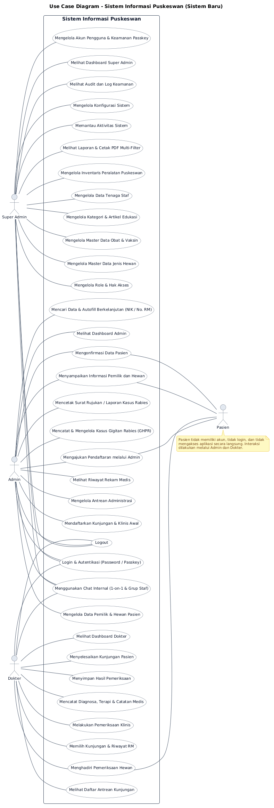
</p>

<details>
  <summary>📄 Berkas Sumber: <code>04-use-case-sistem-baru.puml</code></summary>

[Buka file 04-use-case-sistem-baru.puml](04-use-case-sistem-baru.puml)
</details>

---

### Bagian 3: Pemodelan Proses & Alur Kerja (Process Level)

#### 5. Activity Diagram: Alur Pelayanan Terpadu
Alur aktivitas terpadu mulai dari registrasi loket, autofill NIK, pemeriksaan dokter, hingga penerbitan rekam medis.

<p align="center">
  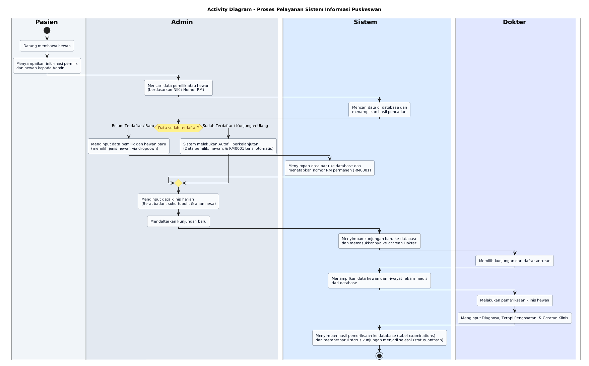
</p>

<details>
  <summary>📄 Berkas Sumber: <code>05-activity-diagram.puml</code></summary>

[Buka file 05-activity-diagram.puml](05-activity-diagram.puml)
</details>

---

#### 6. Activity Diagram: Komunikasi Real-Time Chat Antar-Staf
Alur aktivitas pertukaran pesan instan antar-staf internal melalui WebSockets Laravel Reverb.

<p align="center">
  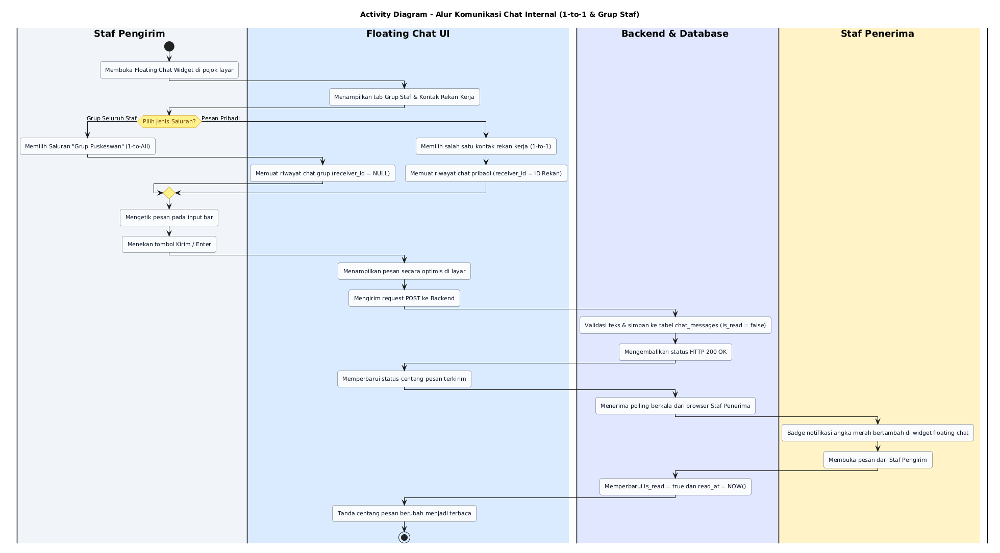
</p>

<details>
  <summary>📄 Berkas Sumber: <code>05b-activity-diagram-chat.puml</code></summary>

[Buka file 05b-activity-diagram-chat.puml](05b-activity-diagram-chat.puml)
</details>

---

#### 7. Flowchart SOP Admin Loket
Prosedur operasional harian khusus Petugas Admin (Pencarian NIK/RM, Autofill, Klinis Awal, & Kasus Gigitan Rabies GHPR).

<p align="center">
  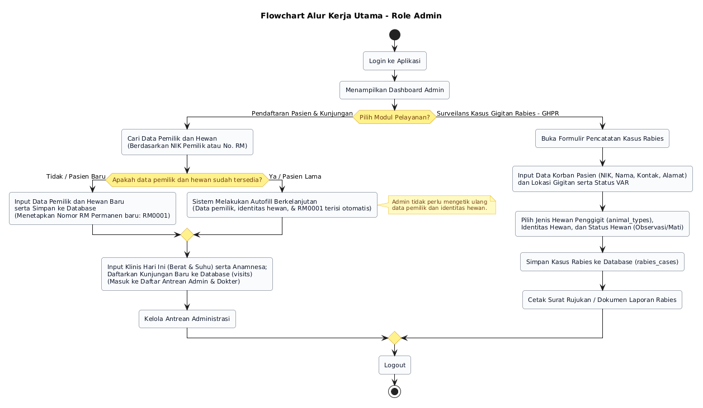
</p>

<details>
  <summary>📄 Berkas Sumber: <code>06-flowchart-admin.puml</code></summary>

[Buka file 06-flowchart-admin.puml](06-flowchart-admin.puml)
</details>

---

#### 8. Flowchart SOP Dokter Hewan
Prosedur operasional harian khusus Dokter Hewan (Antrean Pasien, Tinjau Riwayat, Diagnosa, & Terapi Resep Obat).

<p align="center">
  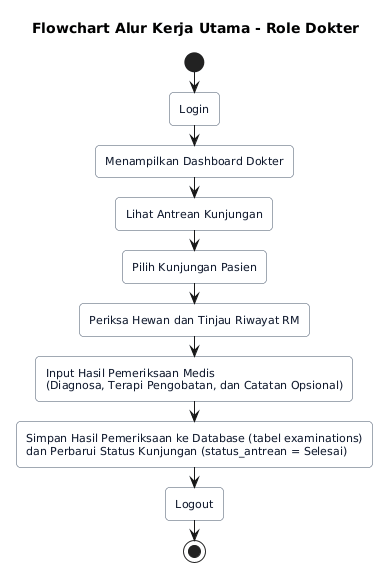
</p>

<details>
  <summary>📄 Berkas Sumber: <code>07-flowchart-dokter.puml</code></summary>

[Buka file 07-flowchart-dokter.puml](07-flowchart-dokter.puml)
</details>

---

#### 9. Flowchart SOP Super Administrator
Prosedur operasional manajerial khusus Super Admin (Tata Kelola Pengguna, Master Data, Inventaris, Live Monitoring, & Laporan PDF).

<p align="center">
  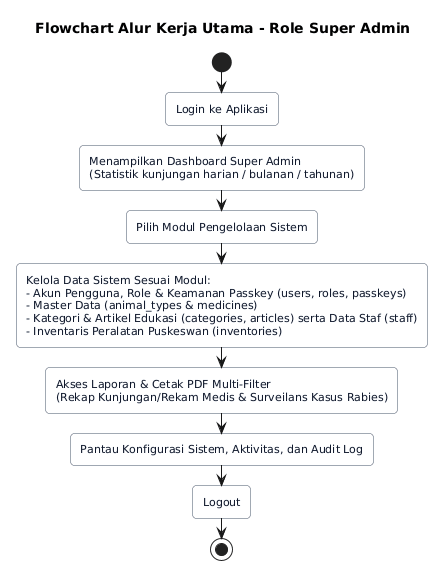
</p>

<details>
  <summary>📄 Berkas Sumber: <code>08-flowchart-super-admin.puml</code></summary>

[Buka file 08-flowchart-super-admin.puml](08-flowchart-super-admin.puml)
</details>

---

### Bagian 4: Perancangan Struktur Data & Objek (Data & Object Level)

#### 10. Class Diagram
Struktur kelas konseptual model Eloquent, atribut, tipe data, operasi, dan multiplicity relasi antar entitas.

<p align="center">
  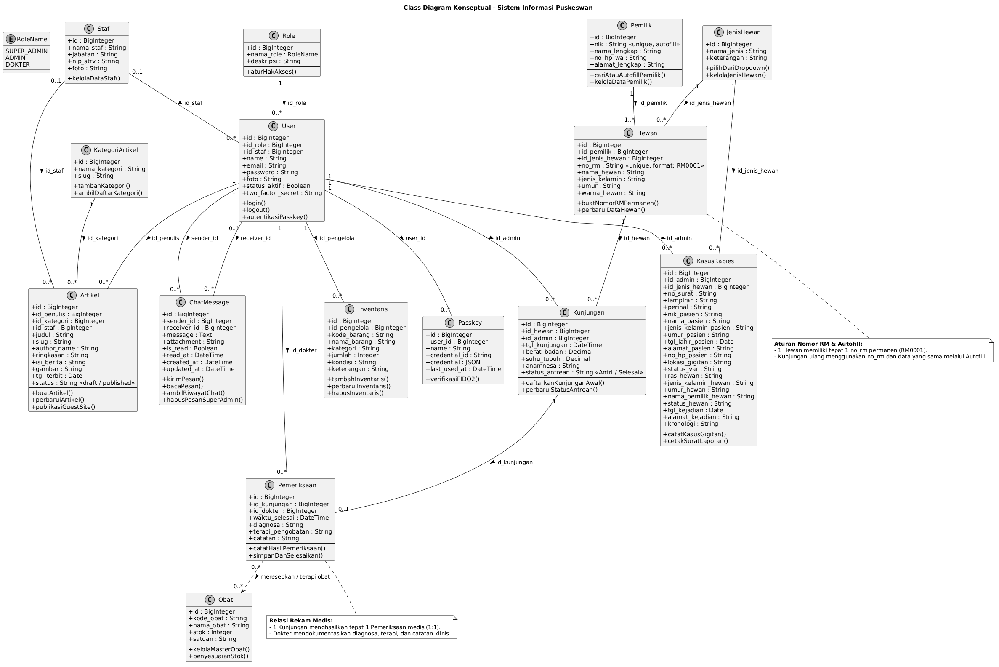
</p>

<details>
  <summary>📄 Berkas Sumber: <code>09-class-diagram.puml</code></summary>

[Buka file 09-class-diagram.puml](09-class-diagram.puml)
</details>

---

#### 11. Entity Relationship Diagram (ERD)
Perancangan skema konseptual basis data relasional mencakup tabel relasional terpadu beserta Primary Key, Foreign Key, dan Constraints.

<p align="center">
  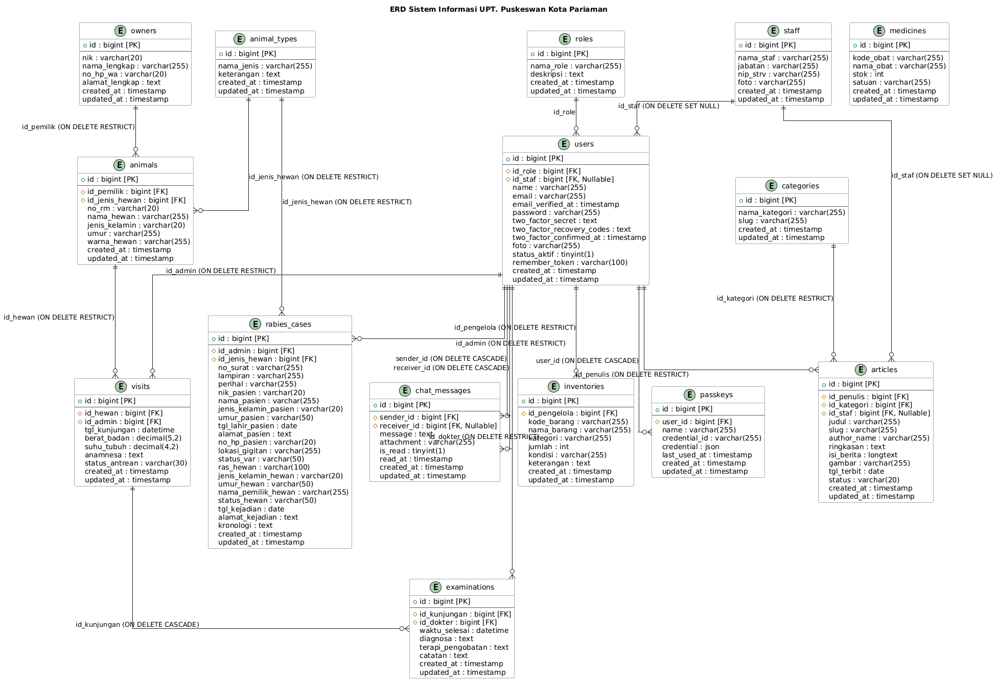
</p>

<details>
  <summary>📄 Berkas Sumber: <code>10-erd.puml</code></summary>

[Buka file 10-erd.puml](10-erd.puml)
</details>

---

### Bagian 5: Interaksi Dinamis & Komponen Sistem (Behavioral & Modular Level)

#### 12. Sequence Diagram: Interaksi Waktu Nyata
Skenario interaksi antar komponen sistem: Pendaftaran Pasien, Pemeriksaan Medis, dan Penanganan Kasus Rabies.

<p align="center">
  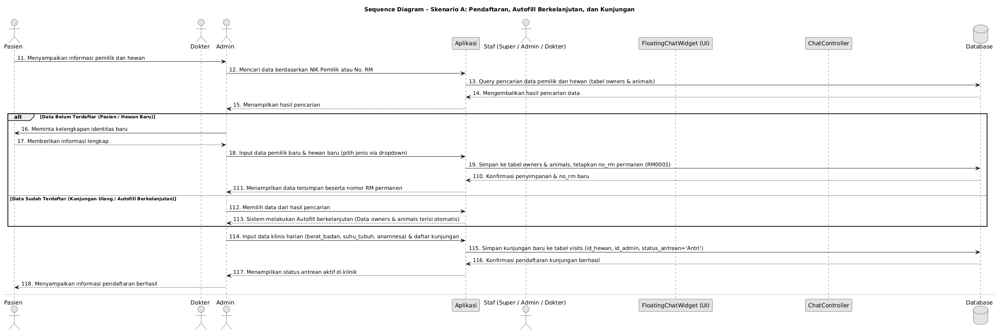
</p>

<details>
  <summary>📄 Berkas Sumber: <code>11-sequence-diagram.puml</code></summary>

[Buka file 11-sequence-diagram.puml](11-sequence-diagram.puml)
</details>

---

#### 13. Component Diagram
Dekomposisi modular sistem informasi (Modul Pelayanan, Antrean, Pemeriksaan Medis, Surveilans Rabies, Real-Time Chat, dan Manajerial).

<p align="center">
  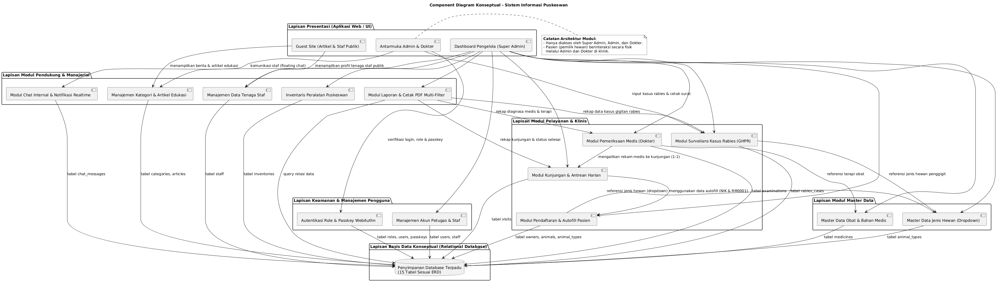
</p>

<details>
  <summary>📄 Berkas Sumber: <code>12-component-diagram.puml</code></summary>

[Buka file 12-component-diagram.puml](12-component-diagram.puml)
</details>

---

### Bagian 6: Arsitektur Perangkat Lunak & Siklus Transaksi (Software Architecture)

#### 14. State Machine Diagram: Siklus Transaksi Kunjungan
Siklus hidup transisi status antrean pasien (*Terdaftar/Antri* $\rightarrow$ *Sedang Diperiksa* $\rightarrow$ *Selesai*).

<p align="center">
  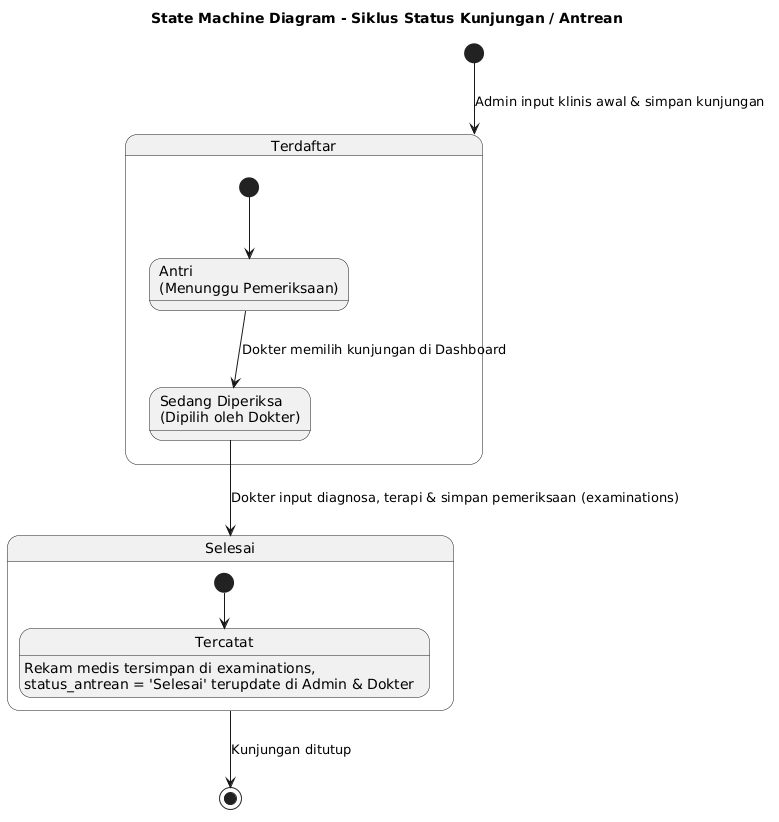
</p>

<details>
  <summary>📄 Berkas Sumber: <code>13-state-machine-diagram.puml</code></summary>

[Buka file 13-state-machine-diagram.puml](13-state-machine-diagram.puml)
</details>

---

#### 15. Package Diagram: Arsitektur Aplikasi
Hierarki struktur paket arsitektur Laravel MVC, Inertia.js React, Controller, Event Broadcast, dan Security Middleware.

<p align="center">
  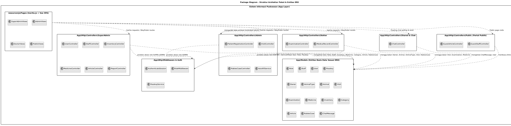
</p>

<details>
  <summary>📄 Berkas Sumber: <code>14-package-diagram.puml</code></summary>

[Buka file 14-package-diagram.puml](14-package-diagram.puml)
</details>

---

### Bagian 7: Infrastruktur Fisik Perangkat Keras (Physical Infrastructure Level)

#### 16. Deployment Diagram: Topologi Fisik & Jaringan
Topologi perangkat keras fisik server (*Client Tier Browser*, *Web & App Tier*, *WebSocket Server Reverb*, dan *Storage Tier MySQL*).

<p align="center">
  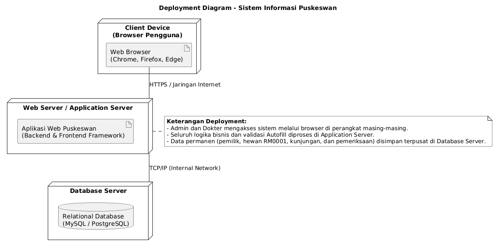
</p>

<details>
  <summary>📄 Berkas Sumber: <code>15-deployment-diagram.puml</code></summary>

[Buka file 15-deployment-diagram.puml](15-deployment-diagram.puml)
</details>

---

## 📁 Struktur Direktori Dokumentasi

```text
docs/uml/
│
├── README.md                          # Dokumentasi naratif utama & katalog diagram visual
│
├── img/                               # Direktori aset gambar hasil render (PNG beresolusi tinggi)
│   ├── 01-bpmn-sistem-lama.png
│   ├── 02-bpmn-sistem-baru.png
│   ├── 03-use-case-sistem-lama.png
│   ├── 04-use-case-sistem-baru.png
│   ├── 05-activity-diagram.png
│   ├── 05b-activity-diagram-chat.png
│   ├── 06-flowchart-admin.png
│   ├── 07-flowchart-dokter.png
│   ├── 08-flowchart-super-admin.png
│   ├── 09-class-diagram.png
│   ├── 10-erd.png
│   ├── 11-sequence-diagram.png
│   ├── 12-component-diagram.png
│   ├── 13-state-machine-diagram.png
│   ├── 14-package-diagram.png
│   └── 15-deployment-diagram.png
│
├── 01-bpmn-sistem-lama.puml           # Berkas kode sumber PlantUML
├── 02-bpmn-sistem-baru.puml
├── 03-use-case-sistem-lama.puml
├── 04-use-case-sistem-baru.puml
├── 05-activity-diagram.puml
├── 05b-activity-diagram-chat.puml
├── 06-flowchart-admin.puml
├── 07-flowchart-dokter.puml
├── 08-flowchart-super-admin.puml
├── 09-class-diagram.puml
├── 10-erd.puml
├── 11-sequence-diagram.puml
├── 12-component-diagram.puml
├── 13-state-machine-diagram.puml
├── 14-package-diagram.puml
└── 15-deployment-diagram.puml
```
